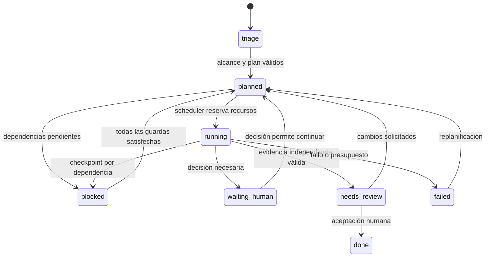

# 01 · PRD y especificación de interfaz — Keel

**Estado:** especificación propuesta; funcionalidades pendientes de
implementación. **Relacionado:** [Arquitectura](02-systems-architecture.md),
[Datos](03-data-model-and-storage.md), [Roadmap y TUI](04-roadmap-and-tui.md).

## 1. Producto y alcance

Keel es un harness unificado de ingeniería centrado en `WorkItem`. Issues,
especificaciones, runs, evidencia, contratos, diffs y notas se consultan desde
la misma tarea. El usuario puede dirigir el trabajo desde una TUI o una GUI, con
ejecución local, en WSL2 o en un host remoto.

Un workspace agrupa proyectos; cada proyecto agrupa N repositorios
independientes (`backend`, `frontend`, `mobile`, `docs`). Un run puede
aprovisionar varios worktrees y registra un `base_sha` por repositorio. El
contexto compartido y los contratos permiten coordinar cambios sin dar a un
agente permiso implícito para modificar los repositorios de sus compañeros.

### Principios

1. **Tarea como unidad de trabajo.** Todo artefacto conserva tarea, run, repo y
   revisión de origen.
2. **Plan verificable.** El Reasoner emite un DAG tipado, complejidad C1–C5,
   roles, scopes y presupuesto estimado. C1–C2 usa un worker directo; C3–C5
   exige justificar cualquier paralelismo.
3. **Git como ancla.** Trabajo aislado por run/worker; integración y publicación
   son operaciones explícitas. Una ejecución completada no equivale a una tarea
   aceptada.
4. **Verificación mecánica.** Runners independientes comprueban las afirmaciones
   del agente.
5. **Cierre humano.** Solo un actor humano autenticado puede llevar una tarea a
   `done`.
6. **Reutilización trazable.** El research se reutiliza cuando coinciden
   incidente, scope y snapshot de repositorios. Se mide el ahorro de
   investigación; leer contexto sigue consumiendo tokens.

### Usuarios y recorridos principales

| Usuario              | Recorrido                                          | Resultado observable                                            |
| -------------------- | -------------------------------------------------- | --------------------------------------------------------------- |
| Desarrollador        | Crear tarea → plan → ejecución → revisión          | Diff y evidencia asociados a commits concretos.                 |
| Responsable técnico  | Aprobar brief/contrato → seguir dependencias       | Fronteras de trabajo claras y cambios de versión visibles.      |
| Equipo con poli-repo | Publicar contrato backend → generar mocks frontend | Frontend avanza antes de que termine la implementación backend. |
| Desarrollador remoto | Abrir TUI por SSH → desconectar → reconectar       | Runs persistentes y recuperación del historial por cursor.      |

## 2. Pantallas 00 a 11

Este inventario conserva la numeración del canvas pen.dev aportada por el
usuario. Es una especificación funcional; la fidelidad visual requiere
contrastar el archivo original.

### 00 · Foundations

Tokens semánticos para superficies, bordes, foco, elevación y estados. Tema
compacto oscuro con tipografía de lectura y monoespaciada para código, IDs y
telemetría. El color siempre se acompaña de texto o icono. Teclado, foco
visible, escalado y reducción de movimiento deben verificarse tanto en vistas
densas como en modales. Los tokens diferencian `lifecycle`, `board_status`,
estado de contrato y estado de conexión.

### 01 · Components

`StateBadge`, `ComplexityPill`, `BudgetMeter`, `FileLockBadge`, `CodeRefLink`,
`ToolCallRow`, `DiffChunkCard`, selector de roles y perfil. El medidor distingue
costo observado, estimado, desconocido y cuota de suscripción. El badge C3–C5
permite ver la justificación del DAG. Una dependencia muestra nombre y versión
del contrato, estado requerido y repo productor.

### 02 · App Shell y navegación global

Selector workspace/proyecto/repositorio y target de ejecución. `Cmd+K`/`Ctrl+K`
busca tareas, runs, archivos y comandos. Active Runs Pill muestra procesos
activos y presupuesto agregado. Daemon Health muestra conexión, latencia medida,
RSS, cola de ingesta y estado de WAL; un cliente desconectado indica cuándo se
sincronizó por última vez.

### 03 · Board: Kanban dual y lista

La vista de ingeniería usa el lifecycle fijo del harness. La vista de negocio
usa columnas configurables (`backlog`, `todo`, `in_progress`, `in_review`,
`completed`). El mapeo no puede eludir las guardas de lifecycle. Filtros por
repo, rol, complejidad, contrato y runs activos. Los bloqueos explican su causa:
contrato, lane, presupuesto, dependencia o entorno.

Mover una tarjeta a `completed` solicita una operación de cierre al daemon. Si
requiere detener runs o saltar revisión, la UI presenta ese efecto y registra la
decisión humana; no basta con cambiar `board_status`.

### 04 · Work Item Inspector

Editor `spec_markdown` con escenarios Dado/Cuando/Entonces; DAG con lanes y
dependencias; lista de worktrees con alias, path, rama, `base_sha` y `head_sha`.
Activity Feed append-only con notas, decisiones, evidencia y eventos
`cross_finding`, `research_reused`, `contract_updated` y `gate_satisfied`. El
panel de contexto muestra fuentes, hashes, antigüedad y motivo de reutilización
o invalidación del research.

### 05 · Run Tree y timeline

Proyección habitual `Root Agent → Workflow Task → Worker Subagent`, conservando
agentes directos cuando así lo indique la fuente. Utilitarios filtrables; padres
desconocidos o contradictorios se muestran explícitamente. Se conserva la
procedencia de cada enlace. Cada tool call tiene un `label` sintáctico legible,
input/output saneado, `wall_ms` medido y `duration_ms` reportado cuando exista.
Nunca se inventan métricas ausentes.

`rate_limit`, `interrupted`, `budget_exceeded`, `fatal_error` y herramientas
`orphan` son estados visibles. El árbol de ejecución no sustituye al DAG de
planificación.

### 06 · Workbench: PTY, preview y diffs

Terminal en el target y worktree seleccionados, shell interactivo configurado,
Starship y dotfiles del usuario. Acciones para Neovim (`nvim +<line> <path>`) y
Lazygit. Visor unificado y side-by-side por repo; `CodeRef` incluye target,
repo, revisión, archivo y línea.

Preview de servidores de desarrollo con registro de puertos por proceso, origen
aislado y reenvío explícito cuando el servidor es remoto. Un puerto escuchando
no implica que deba abrirse automáticamente. Capturas y diffs visuales se
guardan como evidencia.

### 07 · Design Studio

Propuesta de canvas OpenPencil `.op`, comparación antes/después y traducción de
frames a React/Tailwind mediante `fe-design-system`/`integrator`. La
disponibilidad y compatibilidad de `op-web-sdk` quedan como spike de Fase 5.
Mientras tanto, el contrato admite artefactos de diseño y previews; no exige
inventar una API del proveedor. Cada propuesta guarda estado, revisión y
vínculos a la tarea y a los componentes generados.

### 08 · Connections y permisos

MCP Pool Manager con salud, latencia, capacidades y scopes por target.
Connection Broker con referencias al vault y roles `agent_ro`/`agent_rw`. Grant
Rule Builder con `auto`, `ask`, `dry_run_then_ask`, `deny`; cada regla declara
alcance y caducidad. Los secretos no se presentan como contexto del agente. Un
montaje de contexto no concede escritura.

### 09 · Project Setup y Settings

Alta de repositorios, alias único, principal, rama por defecto y target;
validación de `.keel/project.toml`, `shared_dirs` y `always_read`. Configuración
de `auto_triage`, perfiles, modelos por rol, límites de concurrencia y
presupuesto. Los IDs de modelo se eligen según las capacidades del adaptador
instalado; el producto no fija nombres comerciales obsoletos.

### 10 · Inbox de aprobaciones

Cola persistente de operaciones pendientes con destino, herramienta, parámetros,
impacto, evidencia del dry-run y hash de la solicitud. Acciones `Approve Once`,
`Approve Session (15m)`, `Amend & Execute`, `Deny`. Modificar parámetros
invalida la aprobación previa. La UI distingue espera durable del daemon y
límite temporal del runtime; un hook expirado requiere reintento validado, no
una supuesta continuación automática.

### 11 · i18n y consistencia

Interfaz ES/EN. Texto nuevo generado por agentes en inglés por defecto para
búsqueda/evals; se preservan originales humanos, citas, código, nombres y
convenciones del repositorio. Las traducciones son proyecciones identificadas,
no sobrescrituras. Verificar pluralización, fechas, unidades, navegación por
teclado, etiquetas accesibles y consistencia GUI/TUI.

## 3. Estados y guardas

El diagrama describe el recorrido normal. Un cierre forzado es un comando humano
separado: detiene o reconcilia procesos, adjunta razón y evidencia y registra el
bypass. Ningún agente, trigger SQL ni consumidor de eventos puede simular el
actor humano.

| Entidad            | Estados                                                                                              | Autoridad                                          |
| ------------------ | ---------------------------------------------------------------------------------------------------- | -------------------------------------------------- |
| WorkItem.lifecycle | `triage`, `planned`, `running`, `waiting_human`, `blocked`, `needs_review`, `failed`, `done`         | Máquina de estados del daemon.                     |
| Run.status         | `queued`, `initializing`, `running`, `paused`, `completed`, `failed`, `cancelled`, `budget_exceeded` | Supervisor de procesos.                            |
| Contrato           | `draft`, `ready_for_mock`, `implemented`, `deprecated`                                               | Eventos validados del Contract Hub.                |
| Change formal      | `Draft`, `Approved`, `Designed`, `InProgress`, `Review`, `Done`, `Archived`                          | Gates del harness; no es el lifecycle del tablero. |

`blocked → planned → running` es el desbloqueo visible. Publicar un contrato
elimina una guarda; el scheduler comprueba las demás antes de iniciar el
proceso. `implemented` satisface una dependencia `ready_for_mock`; `deprecated`
no satisface nuevas ejecuciones. Los consumidores fijan una versión, nunca un
puntero flotante a “latest”.

## 4. Criterios de aceptación del módulo federado

- **Repositorios:** dado un proyecto backend/frontend/docs, cuando inicia un
  run, cada repo seleccionado tiene su worktree y SHA registrados y el contexto
  apunta al snapshot correcto.
- **Research:** dado un informe del mismo incidente, scope y snapshot con
  antigüedad menor de 48 horas, otra tarea lo reutiliza y registra la fuente.
  Cambiar un SHA obliga a revalidar.
- **Hallazgos:** al repetir `KeelEmitCrossFinding`, se vincula un único bug al
  repo destino. `auto_triage` puede iniciar evaluación dentro de los límites
  configurados.
- **Mock ready:** frontend espera `checkout_api@1`; backend valida y publica
  `ready_for_mock`; el scheduler inicia frontend una sola vez y genera SDK/MSW
  contra v1.
- **Cambio incompatible:** publicar v2 conserva v1 y crea una reconciliación por
  consumidor afectado con diff y evidencia; el cliente no cambia de versión
  silenciosamente.
- **Bloqueos múltiples:** un contrato satisfecho no elimina una pausa humana,
  otra dependencia o una colisión de archivos.
- **Reconexión:** cerrar GUI/TUI no detiene runs; reconectar repone el snapshot
  y los eventos faltantes sin duplicar tareas, aprobaciones ni reconciliaciones.

## 5. Métricas y límites del producto

Medir latencia hasta `ready_for_mock`, tiempo bloqueado por causa,
investigaciones evitadas, tokens observados, reusos invalidados, conflictos de
integración y tiempo hasta revisión. Las metas de rendimiento se validan sobre
un entorno reproducible, no se presentan como resultados ya medidos. El cierre
multi-repo no es un commit atómico entre repositorios: la UI muestra los SHAs y
el estado de integración de cada uno.
