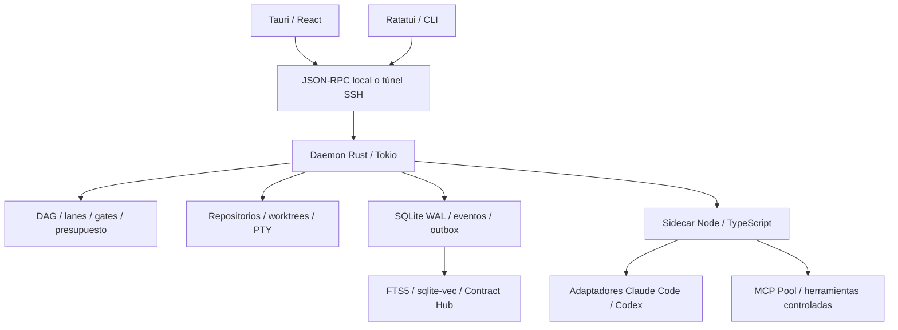

# 02 · Arquitectura de sistemas y runtimes — Keel

**Estado:** arquitectura objetivo propuesta. [PRD](01-prd-ui-spec.md) ·
[DDL](03-data-model-and-storage.md) · [Roadmap](04-roadmap-and-tui.md).

## 1. Fronteras y relación con Mirador

Keel propone un daemon headless en Rust/Tokio, un sidecar Node.js/TypeScript,
TUI Ratatui/Crossterm y GUI Tauri/React. El daemon concentra política, procesos,
Git, scheduler y persistencia. El sidecar adapta proveedores; los clientes
presentan estado y emiten comandos tipados. Ningún cliente escribe directamente
en SQLite.



Se reutilizan conceptos y fixtures de
[ADR-0001](../inherited/mirador/adr/0001-modo-de-operacion-observador-y-runtime.md)
(adaptadores),
[ADR-0002](../inherited/mirador/adr/0002-envelope-de-eventos-y-payload-crudo.md)
(eventos),
[ADR-0004](../inherited/mirador/adr/0004-postura-de-seguridad-y-acceso-a-datos.md)
(permisos),
[ADR-0008](../inherited/mirador/adr/0008-modelo-de-correlacion-revisado.md) y
[ADR-0010](../inherited/mirador/adr/0010-arbol-de-tres-niveles-y-semantica-de-run.md)
(correlación). Los
[ADR-0005](../inherited/mirador/adr/0005-stack-y-estructura-del-monorepo.md) y
[ADR-0007](../inherited/mirador/adr/0007-runtime-bun-en-todo-el-repo.md) siguen
definiendo el stack actual de Mirador. Adoptar este diseño en sus paquetes
requiere una transición explícita; este documento no constituye una migración ni
modifica ADRs aceptados.

## 2. Protocolo y recuperación

Contrato propuesto JSON-RPC 2.0 con envelopes versionados, UTF-8 y framing
NDJSON. Un frame contiene un objeto JSON serializado en una línea; saltos en
contenido van escapados. Límite inicial propuesto de 8 MiB; cuerpos mayores usan
artefactos con tamaño, hash y preview. stdout del sidecar es exclusivamente
protocolo; diagnósticos saneados van por stderr.

| Operación propuesta                                                         | Efecto                                                                                                                                               |
| --------------------------------------------------------------------------- | ---------------------------------------------------------------------------------------------------------------------------------------------------- |
| `work_items.create`, `work_items.transition`                                | Valida identidad, proyecto, revisión esperada y transición.                                                                                          |
| `runs.start`, `runs.pause`, `runs.resume`, `runs.cancel`                    | Encola intención durable; devuelve estado observado por el supervisor.                                                                               |
| `runs.message`, `runs.continue`                                             | Conversación con el run (ADR-0019 §3): mensaje en vivo (Claude en streaming, Codex `turn/steer`) o run hijo que retoma la sesión y el worktree.      |
| `research.lookup`, `research.publish`, `findings.emit`                      | Consulta, publica o vincula investigación y hallazgos.                                                                                               |
| `contracts.publish`, `contracts.transition`, `contracts.depend`             | Publica versiones, evidencia y dependencias fijadas.                                                                                                 |
| `approvals.resolve`                                                         | Consume una aprobación contra el hash exacto. `approve_session` la recuerda el resto del run (15 min); `approve_always` crea una regla del proyecto. |
| `approvals.list`                                                            | Aprobaciones pendientes o, con `include_resolved`, el historial con quién decidió.                                                                   |
| `permissions.rules_list`, `permissions.rule_add`, `permissions.rule_revoke` | Reglas `auto`/`deny` del proyecto (ADR-0019 §4); se revocan, no se borran.                                                                           |
| `events.subscribe`                                                          | Reproduce eventos después de `event_seq`.                                                                                                            |
| `fs.read`, `diff.read`, `pty.attach`                                        | Opera sobre target/repo/worktree autorizados.                                                                                                        |
| `session.bind_agent`                                                        | Vincula la conexión a un run con su token de un solo uso (ADR-0009).                                                                                 |
| `work_items.list`, `work_items.get`, `notes.add`                            | Lectura y notas; para un agente, sólo en el proyecto y tarea del run.                                                                                |
| `handoffs.request`                                                          | Un agente deja nota en su tarea y crea otra en `triage` (ADR-0009).                                                                                  |
| `runs.request`, `runs.requests_list`, `runs.request_resolve`                | El agente pide un run; el humano lo aprueba con las reglas de inicio.                                                                                |
| `session.pair`, `session.pair_status`, `session.pair_resolve`               | Sesión externa: pide entrar, espera y el humano aprueba con scopes.                                                                                  |
| `projects.set_vcs`, `snapshots.restore`                                     | Modo sin VCS confirmado y restauración, sólo humanos (ADR-0010).                                                                                     |
| `projects.list`, `projects.open`, `projects.use`, `projects.status`         | Varios proyectos por daemon (ADR-0019 §2): abrir una carpeta, cambiar el activo de la conexión y leer rama, HEAD y cambios.                          |

Los comandos de mutación llevan `request_id`, `idempotency_key` y revisión
esperada cuando aplique. Identidad humana y permisos provienen de la conexión
autenticada, no de un campo que un agente pueda elegir. Error estructurado con
`code`, `message`, `retryable`, `details` y correlación. Reintentar una mutación
no duplica sus efectos.

Una conexión vinculada con `session.bind_agent` es del actor `agent` y sólo usa
`AGENT_METHODS` de `@keel/core`; la autoridad se comprueba antes de validar los
parámetros y otra vez por recurso en cada handler (ADR-0009 §5). Una sesión
externa emparejada es `agent:ext:<id>` con los scopes que aprobó el humano
(`METHOD_SCOPE`); mientras espera es `pending` y sólo usa `PENDING_METHODS`. Los
esquemas Zod de los métodos viven en `packages/core/src/protocol.ts`.

La transacción guarda cambio, Activity y mensaje en `outbox`. La entrega es al
menos una vez; receptores deduplican por clave estable. Snapshot + cursor
resuelve la reconexión y backpressure evita colas sin límite. Al reiniciar se
reconcilian procesos, leases y worktrees reales antes de relanzar workers. PID
aislado no demuestra identidad de un proceso.

## 3. Targets: nativo, WSL2 y remoto

Contrato lógico propuesto, independiente de las rutas del cliente:

```rust
enum ExecutionTarget {
    NativePosix,
    WindowsHost { shell_profile: String },
    WslBridge { distro: String },
    RemoteSsh { host: String, user: String, port: u16 },
}
```

- **POSIX:** UDS en directorio privado por usuario (`$XDG_RUNTIME_DIR/keel`, con
  fallback específico de plataforma); directorio `0700`, socket `0600`.
- **Windows:** Named Pipe con ACL limitada al usuario. PowerShell/cmd se
  selecciona por perfil, sin asumir `$SHELL` ni opciones POSIX.
- **WSL2:** si el repo vive en Linux, daemon, DB, Git, sidecar y PTYs viven en
  esa distro. El cliente Windows usa un bridge por
  `wsl.exe -d <distro> --exec <bridge>` con argumentos separados. `wslpath`
  traduce rutas para presentación; no se ejecuta Git sobre `\\wsl$`.
  `npiperelay`/`socat` son alternativas de transporte a validar, no dependencias
  obligatorias.
- **SSH:** daemon y DB residen en el host remoto; servicio supervisado (p. ej.
  systemd). SSH autentica el canal hacia un bridge local del daemon. No se
  comparte el archivo SQLite por una unidad de red. Desconectar un cliente no
  mata el servicio.

TMUX mantiene terminales identificadas por run, repo y sesión, evitando
colisiones entre intentos de una tarea. Mosh se reserva para acceso interactivo
a la TUI/terminal remota; el control JSON-RPC y la transferencia de artefactos
usan SSH. Reanudar la conexión repone eventos; no presupone que el runtime del
proveedor pueda reanudar cualquier tool call.

## 4. Multi-repo y resolución del contexto

`work_spaces → projects → project_repos` sustituye el supuesto de un repo por
proyecto. `run_worktrees` fija repo, rama, path y SHAs. Un run es un intento
coordinado de una tarea; si hay varios workers escritores sobre un mismo repo,
cada lane obtiene un worktree propio. Los repos de contexto se materializan como
snapshots de solo lectura en el mismo target. La federación inicial ocurre
dentro de un target; distribuir un mismo run entre hosts queda fuera de la
primera implementación.

```toml
# backend/.keel/project.toml — configuración propuesta
[repo]
alias = "backend"
primary = true

[context]
shared_dirs = ["../docs/specs", "../docs/architecture"]
always_read = ["src/common/interfaces/api-contract.ts"]

[automation]
auto_triage = false

[gates]
lint = ["bun", "run", "lint"]
typecheck = ["bun", "run", "typecheck"]
test = ["bun", "run", "test"]
```

El daemon lee la configuración versionada del snapshot elegido, no un archivo
flotante del checkout principal. Rutas propias se resuelven contra la raíz del
repo; `../<alias>/...` contra el repo registrado con ese alias. Después se
traducen al snapshot/worktree del run y se canonicalizan en el target. Se
rechazan alias desconocidos, escapes y enlaces que salgan de las raíces
concedidas. Un `always_read` faltante bloquea el spawn con diagnóstico.

Antes de iniciar, se registra un manifest con repo IDs, SHAs, configuración,
hashes de archivos y contratos. `always_read` se ingiere explícitamente dentro
del presupuesto de contexto. Si no cabe, se informa el bloqueo; no se omite
silenciosamente. `add_dirs` solo indica accesibilidad; no garantiza lectura ni
modo read-only. El adaptador traduce el manifest a la capacidad vigente del
CLI/SDK. Por ejemplo, `--add-dir` en Claude Code expone directorios adicionales;
las protecciones de escritura se aplican por separado.
[Referencia del CLI de Claude Code](https://code.claude.com/docs/en/cli-reference).

El CLI de Codex instalado debe inspeccionarse al integrar su versión: sus
permisos de directorios adicionales no se tratan como montaje de contexto
read-only. Preferir copias inmutables o sandbox del target para contexto
compartido. El contrato de Keel usa `read_context_dirs`, `write_scopes` y
`required_files`, sin equiparar flags entre proveedores.

### Git y lanes

Ramas `keel/<work-item>/<run>/<lane>`, `base_sha` verificado y comandos mediante
argv. El pool registra creación y cleanup como operaciones recuperables. No
elimina worktrees con cambios sin preservar; TTL solo hace un árbol candidato a
recolección.

Decisiones del humano (2026-10-22), implementadas con `@keel/git` (ADR-0007 §5):

- Los worktrees viven fuera del repo, en
  `$XDG_STATE_HOME/keel/worktrees/<project>/<repo>/<work-item>/<run>/<lane>`.
- Se liberan según el final del run. `cancelled`, `failed`, `interrupted` y
  `budget_exceeded` liberan al terminar. `completed` conserva el worktree
  mientras la tarea está en `needs_review` y lo libera al salir de ahí. Liberar
  siempre rescata antes los cambios sin commit en `refs/keel/rescue/`.
- Un run `execute` sin repositorio git falla explícito antes del spawn. Los runs
  `plan` y `triage_eval` son de sólo lectura y corren en la raíz. El modo sin
  VCS es trabajo de la Fase 1 (SDD 04).

Los locks usan `(target_id, project_repo_id, file_scope)`, con normalización
propia del filesystem. Globs se analizan incluyendo `**`, `?`, clases y archivos
todavía inexistentes. Una comparación solo de prefijos anteriores a `*` no
demuestra ausencia de colisión. Si no puede probarse que los scopes son
disjuntos, se serializa. Adquisición atómica, lease, heartbeat y revisión al
recuperar un proceso; liberar un lease no habilita otro escritor mientras el
primero siga ejecutándose o pendiente de integración.

El DAG se guarda por revisión en `execution_plans`; cada nodo declara ID, tipo
(`research`, `design`, `implement`, `verify`, `integrate`, `human_gate`), repo,
rol, entradas, salidas, predecesores, scopes y límite de ejecución. Los tipos se
validan en la frontera IPC. Las dependencias entre WorkItems se guardan por
separado de las dependencias de contratos.

La integración valida cada repo contra su base y registra los SHAs resultantes.
No existe merge atómico distribuido entre repos: se usa un manifiesto de
integración, orden explícito y recuperación por repo. Avanzar una rama objetivo
invalida la evidencia que dependía de ella.

## 5. Shared Research Hub

SQLite WAL alberga datos relacionales, FTS5 y `sqlite-vec`. El embedder local
produce vectores de 384 dimensiones como perfil inicial; `all-MiniLM-L6-v2` vía
Candle/ONNX es un candidato a evaluar para lenguaje, código y calidad. Se fija
revisión del modelo y normalización. Cambiar dimensión/modelo requiere
reconstruir el índice; no se mezclan espacios vectoriales.

### Consulta, frescura y deduplicación

1. Calcular fingerprint del incidente, scope y snapshot canónico: pares
   ordenados `(repo_id, base_sha)`, hashes del contexto y versiones de
   contratos.
2. Filtrar por workspace, proyecto y permisos antes de exponer resultados. FTS5
   busca símbolos/endpoints y el índice vectorial intenciones; fusionar
   rankings, por ejemplo RRF.
3. Reutilizar únicamente si corresponde al incidente, tiene menos de 48 horas,
   no está invalidado y coincide el snapshot. Similitud semántica por sí sola no
   autoriza un cache hit.
4. Ante cambio de SHA, conservar el informe como referencia histórica y
   revalidar sus fuentes. Un cambio sin relevancia solo puede aceptarse con
   evidencia de revalidación.
5. Antes de investigación costosa, adquirir un lease único por
   proyecto/scope/snapshot/ incidente. Otros agentes esperan el resultado o
   consultan su avance; un lease vencido usa fencing para impedir publicaciones
   tardías de un dueño anterior.
6. Publicar informe saneado y fuentes; actualizar FTS en transacción y encolar
   embedding de forma idempotente. Si falla el embedder se informa modo léxico
   degradado.

Reusar investigación evita repetir inspección y razonamiento; no significa cero
tokens de contexto ni elimina el costo del trabajo independiente. Registrar
costo real y estimado por separado. El detalle de sincronización de índices está
en el documento de datos.

### Hallazgos cruzados

```json
{
  "tool": "KeelEmitCrossFinding",
  "arguments": {
    "target_repo": "backend",
    "severity": "high",
    "target_scope": "auth",
    "summary": "POST /api/v1/auth/callback expects access_token instead of code",
    "details": "Observed 400 response; verify against the pinned contract.",
    "evidence_ids": ["evidence-id"],
    "suggested_contract_diff": { "request.body.code": "string" },
    "idempotency_key": "finding-auth-callback-1"
  }
}
```

El daemon deriva origen, proyecto y actor del run; valida que destino y
evidencia pertenezcan al proyecto. Canonicaliza una firma para deduplicar
incluso si diferentes agentes envían distintas claves de request. En una
transacción crea/vincula `WorkItem(kind=bug, source=agent, repo_id=backend)` en
`triage`, Activity y outbox. El agente de origen sigue dentro de su scope; si su
propio trabajo depende del arreglo, registra la dependencia y hace checkpoint.

`auto_triage=true` permite un worker de evaluación bajo presupuesto y
concurrencia. Puede proponer prioridad, plan y diff de contrato, pero no concede
merge, acceso adicional ni cierre humano. El mismo hallazgo repetido actualiza
evidencia, sin provocar ciclos de bugs duplicados.

## 6. Contract Hub y gates

Cada `api_contracts` contiene una versión inmutable de OpenAPI, JSON Schema,
Protobuf o tipos TypeScript. Cambiar contenido, incluso en draft, publica una
versión nueva. Los estados son eventos append-only; `api_contract_status`
proyecta el estado actual. Así se conserva tanto el esquema original como el
historial `draft → ready_for_mock → implemented → deprecated`.

`ready_for_mock` exige parser válido, referencias resolubles, validación del
formato y un generador compatible con fixtures; no basta un YAML sintácticamente
válido. `implemented` exige evidencia del runner contra un SHA backend concreto.
Deprecar nunca cuenta como “estado superior”. No se retrocede un estado: errores
requieren nueva versión y evento.

```mermaid
sequenceDiagram
    participant BE as Worker backend
    participant Hub as Contract Hub
    participant Sch as Scheduler
    participant FE as Worker frontend
    FE->>Hub: depender de checkout_api@1 / ready_for_mock
    Hub-->>Sch: tarea bloqueada por contrato
    BE->>Hub: publicar v1 draft
    BE->>Hub: ready_for_mock + evidencia
    Hub->>Hub: evento + Activity + outbox en transacción
    Hub-->>Sch: reevaluar dependencias
    Sch->>Sch: comprobar todos los bloqueos, presupuesto y lanes
    Sch-->>FE: iniciar/reanudar intento elegible
    FE->>Hub: leer v1 y verificar hash
    FE->>FE: generar SDK o mocks MSW; implementar UI
    BE->>Hub: publicar v2 + diff de compatibilidad
    Hub-->>FE: contract_updated + tarea de reconciliación
```

Una dependencia requiere un `blocking_contract_id` concreto. Para esperar antes
de que exista el esquema, el plan conserva un bloqueo de planificación por
nombre; al publicar draft, el daemon vincula la versión y crea
`task_contract_dependencies` antes de permitir el spawn. Puede publicarse el
draft antes de programar al consumidor para simplificar este flujo.

Publicación y alta de dependencias son simétricas: agregar una dependencia a un
contrato ya listo debe evaluarse inmediatamente. Cualquier evento, incluida
deprecación, fuerza revisión. El scheduler vuelve a consultar todas las guardas
dentro de la reserva de ejecución. Se recomprueban antes de spawn; una
deprecación posterior provoca checkpoint para consumidores activos sin
reescribir su historial ni deshacer efectos ya ejecutados.

### Cambios de versión

Comparar schemas con herramientas específicas de formato. Si la compatibilidad
es incierta, se pide revisión; no se adivina por diff textual. Registrar
`compatible`, `breaking` o `unknown`. Publicar v2 emite `contract_updated`; cada
consumidor de la familia recibe una subtarea de reconciliación única
`(consumer_work_item_id, replacement_contract_id)` con versiones, hashes y
campos afectados. Un cambio compatible puede cerrar su comprobación automática,
pero el WorkItem sigue requiriendo aceptación humana para `done`.

Los consumidores, incluso tareas ya terminadas que requieran seguimiento, se
localizan en el registro de dependencias conservado. Aprobar la reconciliación
adopta v2 mediante una nueva dependencia explícita; nunca se cambia el ID
bloqueante de una ejecución ya observada.

## 7. Harness derivado del material de Casa Matte

Cinco principios: fases con gates; fuente única con punteros; rationale
desconocido marcado `[INFERIDO — confirmar]`; trabajo mecánico en scripts;
verificación independiente de claims. Las instrucciones del perfil remiten a
documentos canónicos en lugar de duplicarlos.

| Fase formal | Artefacto y guarda                                                              |
| ----------- | ------------------------------------------------------------------------------- |
| Draft       | `proposal.md`, `spec.md` con Dado/Cuando/Entonces.                              |
| Approved    | Gate humano A: brief y alcance congelados.                                      |
| Designed    | `design.md`, contrato versionado, scopes disjuntos; validación y gate humano B. |
| InProgress  | `story.md` autocontenida por worker, derivada del contrato y diseño.            |
| Review      | Runner independiente y `qa-gate.md`: PASS, CONCERNS, FAIL o WAIVED.             |
| Done        | Aceptación humana, evidencia y commits por repo; FAIL vuelve a implementación.  |
| Archived    | Gate humano C: promover a ADR/SDD/roadmap y archivar la carpeta efímera.        |

Fast-path para cambios acotados. Ciclo formal para contratos
públicos/invariantes, paralelismo de dos o más engineers o módulos grandes sin
diseño. Analyst read-only, architect limitado al diseño, engineers por scopes y
reviewer read-only. El protocolo `grilling` inspecciona primero el repo,
pregunta una cosa cada vez con propuesta razonada y resuelve dependencias de
decisión antes de descender. Ninguna pregunta ya respondida se repite.

En poli-repo, una unidad `changes/<id>` referencia varias ramas; no se fuerza la
relación global 1:1 entre change y rama del caso mono-repo. El hash
`.contract-lock` se deriva de versiones y hashes del manifest; solo comandos del
daemon actualizan esa proyección.

| Gate mecánico          | Regla propuesta                                                                  |
| ---------------------- | -------------------------------------------------------------------------------- |
| `check-commit`         | Ramas protegidas, Conventional Commits y atribución según política del proyecto. |
| `block-secrets`        | Acceso a secretos restringido; `.env.example` permitido cuando sea plantilla.    |
| `readonly-lock`        | `.keel/readonly` impide escrituras controladas por Keel.                         |
| `protect-generated`    | SDKs solo por generador; migraciones vinculadas a decisión aprobada.             |
| `protect-change-state` | Estado y lock del change cambian mediante comandos validados.                    |
| `validate-gate`        | Artefactos y escenarios válidos antes de avanzar o integrar.                     |
| `verify-claims`        | Lint/types/tests independientes en el SHA exacto; regla delta-verde.             |

`post-edit-checks`, `session-focus` y `stop-roadmap-reminder` aportan feedback,
contexto y recordatorio de canonización. El daemon distingue checks bloqueantes
de avisos. Los hooks del proveedor complementan enforcement del daemon/sandbox;
el texto del prompt no es un límite de seguridad. QA WAIVED requiere actor
humano, razón, alcance y caducidad.

Tres capas de memoria: research vivo en SQLite; memoria canónica versionada en
`docs/` (ADRs/SDDs/mapas); bitácora de sesión/handoff con IDs, estado y cursor
para continuidad.

## 8. Adaptadores oficiales, auth y telemetría

El adaptador declara capacidades por versión: streaming, cancelación,
reanudación, aprobaciones, subagentes, directorios y métricas. Keel normaliza
relaciones nativas y, cuando haga falta, programa workers independientes. No se
afirma que un proveedor carezca siempre de subagentes. Los IDs externos se
conservan junto al proveedor/sesión, sin asumir unicidad global.

Para Codex, el SDK TypeScript permite ejecutar y reanudar threads; la
documentación oficial orienta a `app-server` para clientes con autenticación,
aprobaciones e historial. El sidecar de Keel debe elegir la superficie que cubra
cada capacidad y fijar versiones verificadas.
[Codex SDK](https://learn.chatgpt.com/docs/codex-sdk).

Codex administra su login y caché de credenciales; puede usar el almacén del SO
o `auth.json`. Keel delega el login al flujo oficial y emite `auth_required` si
falta sesión. No interpreta `~/.codex/sessions` como vault ni extrae tokens para
construir endpoints privados. La opción de suscripción depende del método
admitido y del acceso de la cuenta.
[Autenticación de Codex](https://learn.chatgpt.com/docs/auth).

Claude Agent SDK usa métodos de autenticación documentados; su documentación
exige aprobación previa para que terceros ofrezcan login/rate limits de
claude.ai en sus productos. Por eso la propuesta no promete reutilizar
suscripciones de Claude en el sidecar ni parsear `~/.claude.json` como
credencial OAuth. Integrar el CLI del usuario y ofrecer un SDK en Keel son
capacidades distintas que deben validarse por separado.
[Claude Agent SDK](https://code.claude.com/docs/en/agent-sdk/overview).

No hay fallback silencioso de suscripción a API facturada. El modo de auth y
medición de costos queda explícito por perfil. Secretos de conexiones usan
referencias al vault; `zeroize` reduce permanencia en buffers Rust, sin prometer
borrar todas las copias del runtime Node.

Los eventos conservan `source`, `fidelity`, versión de adaptador, tiempos y
payload saneado. Kinds desconocidos se ingieren; derivaciones incompletas
admiten null. `label` se obtiene de comando/path/patrón, nunca resumiendo con
otro LLM. `wall_ms` usa reloj monotónico para llamadas observadas en vivo; tras
recuperación se etiqueta cualquier estimación. `duration_ms` mantiene la
semántica del proveedor. Los nodos workflow tienen entidad propia y no fingen
ser agentes.

## 9. Aprobaciones, terminal y presupuesto

El daemon retiene operaciones antes de despacharlas. Un hook con timeout debe
denegar al expirar; el inbox durable conserva la intención y permite un nuevo
intento idempotente tras revalidar. `dry_run` solo se ofrece para herramientas
con semántica de simulación comprobable: no se ejecuta Bash arbitrario bajo una
etiqueta de seguridad. Cambiar comando, target, hash del diff o schema invalida
el grant.

PTYs interactivos cargan la configuración del shell elegido; en Bash un login
shell no garantiza por sí solo cargar `.bashrc`. Los runners deterministas usan
entorno explícito. Neovim/Lazygit se lanzan mediante argv dentro del target;
suspender y restaurar el terminal de la TUI debe funcionar incluso si el
programa hijo falla.

El watchdog reserva presupuesto por worker y suma descendientes. Al exceder el
límite observado detiene nuevos trabajos y solicita cancelación, con kill del
grupo de procesos si corresponde. El objetivo de reacción local menor de 50 ms
se mide desde que se recibe la señal de consumo; no garantiza detener
facturación remota ni conocer tokens pendientes. Sin costo observable, mostrar
desconocido/cuota y aplicar límites de tokens, tiempo y concurrencia. Los
mínimos de permisos y presupuesto existen desde Fase 1; Fase 6 los completa.
