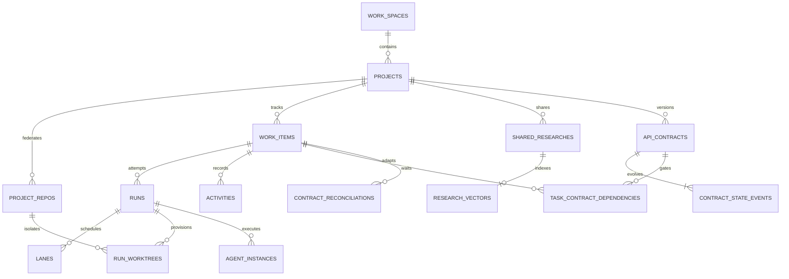

# 03 · Modelo de datos, persistencia y Shared Hub — Keel

**Estado:** esquema de referencia propuesto; no es una migración del store de
Mirador. [Arquitectura](02-systems-architecture.md) · [PRD](01-prd-ui-spec.md).

## 1. Reglas de almacenamiento

SQLite reside en disco local del target que ejecuta el daemon. Un escritor
coordinado y transacciones cortas; lectores con snapshots. WAL no crea múltiples
escritores simultáneos ni una base distribuida. Habilitar foreign keys y timeout
en cada conexión. `synchronous=FULL` es el punto de partida para decisiones
durables; otra política exige medir durabilidad.
[Documentación de WAL](https://www.sqlite.org/wal.html).

IDs de dominio ULID en TEXT, timestamps UTC ISO 8601, booleanos INTEGER con
CHECK, JSON validado. Importes en micro-USD enteros (`1 USD = 1_000_000`) y null
si el costo es desconocido. Los SHAs se conservan como texto para admitir
formatos Git distintos; el daemon valida con Git. Referencias compuestas evitan
asociar tareas, repos, runs o contratos de proyectos diferentes.

Eventos y versiones de contratos son append-only. Proyecciones, leases y outbox
sí cambian. Archivar un proyecto preserva el historial; el borrado por retención
es una operación de mantenimiento explícita. El daemon es el único escritor
autorizado. Restricciones SQL no sustituyen permisos, validación de actores ni
control de transiciones en el servicio.

## 2. DDL relacional y FTS5

Este bloque se ejecuta sobre una base vacía con FTS5 y funciones JSON
disponibles. El bloque vectorial de la sección 3 requiere cargar `sqlite-vec`
antes de ejecutarse. Las migraciones de implementación deberán versionar y
probar este esquema, sin aplicarlo a Postgres/Mirador.

```sql
PRAGMA journal_mode = WAL;
PRAGMA synchronous = FULL;
PRAGMA foreign_keys = ON;
PRAGMA busy_timeout = 5000;

CREATE TABLE work_spaces (
    id TEXT PRIMARY KEY NOT NULL,
    name TEXT NOT NULL,
    target_id TEXT NOT NULL,
    root_path TEXT NOT NULL,
    created_at TEXT NOT NULL DEFAULT (strftime('%Y-%m-%dT%H:%M:%fZ', 'now')),
    UNIQUE(target_id, root_path)
);

CREATE TABLE projects (
    id TEXT PRIMARY KEY NOT NULL,
    workspace_id TEXT NOT NULL REFERENCES work_spaces(id),
    name TEXT NOT NULL,
    slug TEXT NOT NULL,
    board_status_config TEXT NOT NULL DEFAULT '{}' CHECK (json_valid(board_status_config)),
    budget_micro_usd_cap INTEGER CHECK (budget_micro_usd_cap >= 0),
    auto_triage INTEGER NOT NULL DEFAULT 0 CHECK (auto_triage IN (0, 1)),
    archived_at TEXT,
    created_at TEXT NOT NULL DEFAULT (strftime('%Y-%m-%dT%H:%M:%fZ', 'now')),
    UNIQUE(workspace_id, slug)
);

CREATE TABLE project_repos (
    id TEXT PRIMARY KEY NOT NULL,
    project_id TEXT NOT NULL REFERENCES projects(id),
    alias TEXT NOT NULL,
    repo_url TEXT NOT NULL,
    default_branch TEXT NOT NULL DEFAULT 'main',
    local_path TEXT NOT NULL,
    is_primary INTEGER NOT NULL DEFAULT 0 CHECK (is_primary IN (0, 1)),
    archived_at TEXT,
    created_at TEXT NOT NULL DEFAULT (strftime('%Y-%m-%dT%H:%M:%fZ', 'now')),
    UNIQUE(project_id, alias),
    UNIQUE(project_id, local_path),
    UNIQUE(id, project_id)
);
CREATE UNIQUE INDEX idx_one_primary_repo ON project_repos(project_id)
    WHERE is_primary = 1 AND archived_at IS NULL;

CREATE TABLE work_items (
    id TEXT PRIMARY KEY NOT NULL,
    project_id TEXT NOT NULL REFERENCES projects(id),
    repo_id TEXT,
    parent_work_item_id TEXT,
    display_id TEXT NOT NULL,
    title TEXT NOT NULL,
    spec_markdown TEXT NOT NULL DEFAULT '',
    kind TEXT NOT NULL CHECK (kind IN ('feature', 'bug', 'refactor', 'chore', 'docs', 'research')),
    source TEXT NOT NULL CHECK (source IN ('human', 'agent', 'integration')),
    lifecycle TEXT NOT NULL DEFAULT 'triage' CHECK (lifecycle IN (
        'triage', 'planned', 'running', 'waiting_human',
        'blocked', 'needs_review', 'failed', 'done'
    )),
    board_status TEXT NOT NULL DEFAULT 'backlog',
    priority TEXT NOT NULL DEFAULT 'medium' CHECK (priority IN ('urgent', 'high', 'medium', 'low')),
    complexity_score INTEGER CHECK (complexity_score BETWEEN 1 AND 5),
    assigned_role TEXT,
    dedupe_key TEXT,
    budget_micro_usd_cap INTEGER CHECK (budget_micro_usd_cap >= 0),
    revision INTEGER NOT NULL DEFAULT 0 CHECK (revision >= 0),
    archived_at TEXT,
    created_at TEXT NOT NULL DEFAULT (strftime('%Y-%m-%dT%H:%M:%fZ', 'now')),
    updated_at TEXT NOT NULL DEFAULT (strftime('%Y-%m-%dT%H:%M:%fZ', 'now')),
    UNIQUE(project_id, display_id),
    UNIQUE(id, project_id),
    FOREIGN KEY(repo_id, project_id) REFERENCES project_repos(id, project_id),
    FOREIGN KEY(parent_work_item_id, project_id) REFERENCES work_items(id, project_id)
);
CREATE INDEX idx_work_items_state ON work_items(project_id, lifecycle);
CREATE UNIQUE INDEX idx_active_dedupe ON work_items(project_id, dedupe_key)
    WHERE dedupe_key IS NOT NULL AND lifecycle <> 'done' AND archived_at IS NULL;

CREATE TABLE command_receipts (
    project_id TEXT NOT NULL REFERENCES projects(id),
    actor_id TEXT NOT NULL,
    idempotency_key TEXT NOT NULL,
    request_hash TEXT NOT NULL,
    result_json TEXT NOT NULL CHECK (json_valid(result_json)),
    created_at TEXT NOT NULL DEFAULT (strftime('%Y-%m-%dT%H:%M:%fZ', 'now')),
    PRIMARY KEY(project_id, actor_id, idempotency_key)
);

CREATE TABLE execution_plans (
    id TEXT PRIMARY KEY NOT NULL,
    project_id TEXT NOT NULL,
    work_item_id TEXT NOT NULL,
    revision INTEGER NOT NULL CHECK (revision > 0),
    dag_json TEXT NOT NULL CHECK (json_valid(dag_json)),
    estimated_cost_micro_usd INTEGER CHECK (estimated_cost_micro_usd >= 0),
    rationale TEXT NOT NULL,
    created_at TEXT NOT NULL DEFAULT (strftime('%Y-%m-%dT%H:%M:%fZ', 'now')),
    UNIQUE(work_item_id, revision),
    UNIQUE(id, project_id),
    FOREIGN KEY(work_item_id, project_id) REFERENCES work_items(id, project_id)
);

CREATE TABLE work_item_dependencies (
    project_id TEXT NOT NULL,
    waiting_work_item_id TEXT NOT NULL,
    blocking_work_item_id TEXT NOT NULL,
    required_lifecycle TEXT NOT NULL CHECK (required_lifecycle IN ('needs_review', 'done')),
    PRIMARY KEY(waiting_work_item_id, blocking_work_item_id),
    CHECK (waiting_work_item_id <> blocking_work_item_id),
    FOREIGN KEY(waiting_work_item_id, project_id) REFERENCES work_items(id, project_id),
    FOREIGN KEY(blocking_work_item_id, project_id) REFERENCES work_items(id, project_id)
);

CREATE TABLE runs (
    id TEXT PRIMARY KEY NOT NULL,
    project_id TEXT NOT NULL,
    work_item_id TEXT NOT NULL,
    plan_id TEXT,
    purpose TEXT NOT NULL DEFAULT 'execute' CHECK (purpose IN ('plan', 'execute', 'triage_eval')),
    status TEXT NOT NULL DEFAULT 'queued' CHECK (status IN (
        'queued', 'initializing', 'running', 'paused', 'waiting_human', 'completed',
        'failed', 'cancelled', 'interrupted', 'budget_exceeded'
    )),
    end_reason TEXT CHECK (end_reason IN (
        'completed', 'interrupted', 'timeout', 'budget_exceeded', 'rate_limit', 'fatal_error', 'cancelled'
    )),
    context_manifest_json TEXT NOT NULL DEFAULT '{}' CHECK (json_valid(context_manifest_json)),
    input_tokens INTEGER NOT NULL DEFAULT 0 CHECK (input_tokens >= 0),
    output_tokens INTEGER NOT NULL DEFAULT 0 CHECK (output_tokens >= 0),
    total_cost_micro_usd INTEGER CHECK (total_cost_micro_usd >= 0),
    cost_kind TEXT NOT NULL DEFAULT 'unknown' CHECK (cost_kind IN ('observed', 'estimated', 'unknown')),
    started_at TEXT,
    ended_at TEXT,
    created_at TEXT NOT NULL DEFAULT (strftime('%Y-%m-%dT%H:%M:%fZ', 'now')),
    UNIQUE(id, project_id),
    FOREIGN KEY(plan_id, project_id) REFERENCES execution_plans(id, project_id),
    FOREIGN KEY(work_item_id, project_id) REFERENCES work_items(id, project_id)
);
CREATE INDEX idx_runs_item ON runs(work_item_id, status);
-- Vivo = puede volver a consumir recursos sin un run nuevo. `interrupted` es
-- terminal: el reintento es otro run (ADR-0006).
CREATE UNIQUE INDEX idx_live_run ON runs(work_item_id)
    WHERE status IN ('queued', 'initializing', 'running', 'paused', 'waiting_human');

CREATE TABLE lanes (
    id TEXT PRIMARY KEY NOT NULL,
    project_id TEXT NOT NULL,
    run_id TEXT NOT NULL,
    project_repo_id TEXT NOT NULL,
    name TEXT NOT NULL,
    file_scopes_json TEXT NOT NULL CHECK (json_valid(file_scopes_json)),
    status TEXT NOT NULL DEFAULT 'pending' CHECK (status IN ('pending', 'active', 'merged', 'failed')),
    lease_expires_at TEXT,
    fencing_token INTEGER NOT NULL DEFAULT 0,
    UNIQUE(id, run_id, project_repo_id),
    FOREIGN KEY(run_id, project_id) REFERENCES runs(id, project_id),
    FOREIGN KEY(project_repo_id, project_id) REFERENCES project_repos(id, project_id)
);

CREATE TABLE run_worktrees (
    id TEXT PRIMARY KEY NOT NULL,
    project_id TEXT NOT NULL,
    run_id TEXT NOT NULL,
    project_repo_id TEXT NOT NULL,
    lane_id TEXT,
    slot TEXT NOT NULL DEFAULT 'root',
    worktree_path TEXT NOT NULL UNIQUE,
    base_sha TEXT NOT NULL,
    head_sha TEXT,
    branch_name TEXT NOT NULL,
    access_mode TEXT NOT NULL DEFAULT 'write' CHECK (access_mode IN ('read', 'write')),
    created_at TEXT NOT NULL DEFAULT (strftime('%Y-%m-%dT%H:%M:%fZ', 'now')),
    UNIQUE(run_id, project_repo_id, slot),
    UNIQUE(project_repo_id, branch_name),
    FOREIGN KEY(run_id, project_id) REFERENCES runs(id, project_id),
    FOREIGN KEY(project_repo_id, project_id) REFERENCES project_repos(id, project_id),
    FOREIGN KEY(lane_id, run_id, project_repo_id) REFERENCES lanes(id, run_id, project_repo_id)
);

CREATE TABLE work_item_blocks (
    id TEXT PRIMARY KEY NOT NULL,
    work_item_id TEXT NOT NULL REFERENCES work_items(id),
    kind TEXT NOT NULL CHECK (kind IN ('planning', 'dependency', 'lane', 'human', 'budget', 'environment')),
    reason_key TEXT NOT NULL,
    details_json TEXT NOT NULL CHECK (json_valid(details_json)),
    cleared_at TEXT,
    UNIQUE(work_item_id, kind, reason_key)
);

-- `state` en workflow_nodes, agent_instances y tool_calls es una proyección
-- calculada por el daemon desde `events` (ADR-0006, nivel «nodo de ejecución»);
-- nunca la escribe un cliente.
CREATE TABLE workflow_nodes (
    id TEXT PRIMARY KEY NOT NULL,
    run_id TEXT NOT NULL REFERENCES runs(id),
    title TEXT NOT NULL,
    state TEXT NOT NULL DEFAULT 'pending' CHECK (state IN (
        'pending', 'running', 'waiting_human', 'succeeded', 'failed', 'cancelled', 'interrupted', 'orphan'
    )),
    UNIQUE(id, run_id)
);

CREATE TABLE agent_instances (
    id TEXT PRIMARY KEY NOT NULL,
    run_id TEXT NOT NULL REFERENCES runs(id),
    provider TEXT NOT NULL,
    session_id TEXT NOT NULL,
    external_agent_id TEXT,
    parent_agent_id TEXT,
    parent_workflow_id TEXT,
    parent_source TEXT CHECK (parent_source IN ('sdk', 'transcript', 'launch', 'prompt')),
    parent_discrepancy INTEGER NOT NULL DEFAULT 0 CHECK (parent_discrepancy IN (0, 1)),
    classification TEXT NOT NULL CHECK (classification IN ('root', 'worker', 'utility')),
    state TEXT NOT NULL DEFAULT 'pending' CHECK (state IN (
        'pending', 'running', 'waiting_human', 'succeeded', 'failed', 'cancelled', 'interrupted', 'orphan'
    )),
    agent_type TEXT,
    model TEXT,
    first_seen TEXT NOT NULL,
    last_seen TEXT NOT NULL,
    stopped_at TEXT,
    stop_failure_error TEXT,
    UNIQUE(id, run_id),
    UNIQUE(run_id, provider, session_id, external_agent_id),
    CHECK (parent_agent_id IS NULL OR parent_workflow_id IS NULL),
    FOREIGN KEY(parent_agent_id, run_id) REFERENCES agent_instances(id, run_id),
    FOREIGN KEY(parent_workflow_id, run_id) REFERENCES workflow_nodes(id, run_id)
);

CREATE TABLE tool_calls (
    id TEXT PRIMARY KEY NOT NULL,
    run_id TEXT NOT NULL REFERENCES runs(id),
    agent_id TEXT NOT NULL,
    tool_use_id TEXT NOT NULL,
    tool_name TEXT NOT NULL,
    label TEXT NOT NULL CHECK (length(label) > 0),
    state TEXT NOT NULL CHECK (state IN (
        'pending', 'running', 'waiting_human', 'succeeded', 'failed', 'cancelled', 'interrupted', 'orphan'
    )),
    started_at TEXT NOT NULL,
    ended_at TEXT,
    wall_ms INTEGER CHECK (wall_ms >= 0),
    duration_ms INTEGER CHECK (duration_ms >= 0),
    input_json TEXT CHECK (input_json IS NULL OR json_valid(input_json)),
    output_json TEXT CHECK (output_json IS NULL OR json_valid(output_json)),
    artifact_ref TEXT,
    error_message TEXT,
    UNIQUE(agent_id, tool_use_id),
    FOREIGN KEY(agent_id, run_id) REFERENCES agent_instances(id, run_id)
);

CREATE TABLE events (
    event_seq INTEGER PRIMARY KEY AUTOINCREMENT,
    id TEXT NOT NULL UNIQUE,
    project_id TEXT NOT NULL REFERENCES projects(id),
    run_id TEXT,
    source TEXT NOT NULL,
    source_event_key TEXT NOT NULL,
    fidelity TEXT NOT NULL CHECK (fidelity IN ('full', 'partial')),
    adapter_version TEXT NOT NULL,
    kind TEXT NOT NULL,
    occurred_at TEXT,
    received_at TEXT NOT NULL DEFAULT (strftime('%Y-%m-%dT%H:%M:%fZ', 'now')),
    payload_json TEXT NOT NULL CHECK (json_valid(payload_json)),
    UNIQUE(project_id, source, source_event_key),
    FOREIGN KEY(run_id, project_id) REFERENCES runs(id, project_id)
);

CREATE TABLE activities (
    id TEXT PRIMARY KEY NOT NULL,
    project_id TEXT NOT NULL,
    work_item_id TEXT NOT NULL,
    actor_kind TEXT NOT NULL CHECK (actor_kind IN ('human', 'agent', 'system')),
    actor_id TEXT NOT NULL,
    verb TEXT NOT NULL,
    details_json TEXT NOT NULL CHECK (json_valid(details_json)),
    dedupe_key TEXT NOT NULL,
    created_at TEXT NOT NULL DEFAULT (strftime('%Y-%m-%dT%H:%M:%fZ', 'now')),
    UNIQUE(project_id, dedupe_key),
    FOREIGN KEY(work_item_id, project_id) REFERENCES work_items(id, project_id)
);

CREATE TABLE evidence (
    id TEXT PRIMARY KEY NOT NULL,
    project_id TEXT NOT NULL,
    run_id TEXT NOT NULL,
    kind TEXT NOT NULL,
    artifact_ref TEXT NOT NULL,
    sha256 TEXT NOT NULL,
    metadata_json TEXT NOT NULL CHECK (json_valid(metadata_json)),
    created_at TEXT NOT NULL DEFAULT (strftime('%Y-%m-%dT%H:%M:%fZ', 'now')),
    UNIQUE(id, project_id),
    FOREIGN KEY(run_id, project_id) REFERENCES runs(id, project_id)
);

CREATE TABLE notes (
    id TEXT PRIMARY KEY NOT NULL,
    work_item_id TEXT NOT NULL REFERENCES work_items(id),
    author TEXT NOT NULL,
    content_markdown TEXT NOT NULL,
    created_at TEXT NOT NULL DEFAULT (strftime('%Y-%m-%dT%H:%M:%fZ', 'now'))
);

CREATE TABLE outbox (
    id INTEGER PRIMARY KEY AUTOINCREMENT,
    project_id TEXT NOT NULL REFERENCES projects(id),
    event_type TEXT NOT NULL,
    aggregate_id TEXT NOT NULL,
    dedupe_key TEXT NOT NULL UNIQUE,
    payload_json TEXT NOT NULL CHECK (json_valid(payload_json)),
    created_at TEXT NOT NULL DEFAULT (strftime('%Y-%m-%dT%H:%M:%fZ', 'now')),
    delivered_at TEXT,
    attempts INTEGER NOT NULL DEFAULT 0 CHECK (attempts >= 0)
);
CREATE INDEX idx_outbox_pending ON outbox(id) WHERE delivered_at IS NULL;

CREATE TABLE shared_researches (
    id TEXT PRIMARY KEY NOT NULL,
    project_id TEXT NOT NULL REFERENCES projects(id),
    origin_work_item_id TEXT,
    origin_repo_id TEXT NOT NULL,
    target_scope TEXT NOT NULL,
    incident_key TEXT NOT NULL,
    snapshot_hash TEXT NOT NULL,
    snapshot_manifest_json TEXT NOT NULL CHECK (json_valid(snapshot_manifest_json)),
    summary TEXT NOT NULL,
    findings_md TEXT NOT NULL,
    root_cause_analysis TEXT,
    contract_diff_json TEXT CHECK (contract_diff_json IS NULL OR json_valid(contract_diff_json)),
    sources_json TEXT NOT NULL CHECK (json_valid(sources_json)),
    created_by_agent TEXT NOT NULL REFERENCES agent_instances(id),
    created_at TEXT NOT NULL DEFAULT (strftime('%Y-%m-%dT%H:%M:%fZ', 'now')),
    invalidated_at TEXT,
    UNIQUE(id, project_id),
    FOREIGN KEY(origin_work_item_id, project_id) REFERENCES work_items(id, project_id),
    FOREIGN KEY(origin_repo_id, project_id) REFERENCES project_repos(id, project_id)
);
CREATE INDEX idx_research_lookup ON shared_researches(
    project_id, target_scope, incident_key, snapshot_hash, created_at
) WHERE invalidated_at IS NULL;

CREATE TABLE research_claims (
    project_id TEXT NOT NULL,
    target_scope TEXT NOT NULL,
    incident_key TEXT NOT NULL,
    snapshot_hash TEXT NOT NULL,
    owner_run_id TEXT NOT NULL,
    fencing_token INTEGER NOT NULL CHECK (fencing_token > 0),
    lease_expires_at TEXT NOT NULL,
    PRIMARY KEY(project_id, target_scope, incident_key, snapshot_hash),
    FOREIGN KEY(owner_run_id, project_id) REFERENCES runs(id, project_id)
);

CREATE TABLE research_embedding_jobs (
    research_id TEXT PRIMARY KEY NOT NULL REFERENCES shared_researches(id),
    model_id TEXT NOT NULL,
    model_revision TEXT NOT NULL,
    content_hash TEXT NOT NULL,
    dimensions INTEGER NOT NULL DEFAULT 384 CHECK (dimensions = 384),
    state TEXT NOT NULL CHECK (state IN ('pending', 'ready', 'failed')),
    error_message TEXT
);

CREATE VIRTUAL TABLE research_fts USING fts5(
    research_id UNINDEXED,
    project_id UNINDEXED,
    title,
    findings_md,
    tokenize = 'unicode61'
);
CREATE TRIGGER research_fts_insert AFTER INSERT ON shared_researches BEGIN
    INSERT INTO research_fts(research_id, project_id, title, findings_md)
    VALUES (NEW.id, NEW.project_id, NEW.summary, NEW.findings_md);
END;
CREATE TRIGGER research_fts_update AFTER UPDATE ON shared_researches BEGIN
    DELETE FROM research_fts WHERE research_id = OLD.id;
    INSERT INTO research_fts(research_id, project_id, title, findings_md)
    VALUES (NEW.id, NEW.project_id, NEW.summary, NEW.findings_md);
END;
CREATE TRIGGER research_fts_delete AFTER DELETE ON shared_researches BEGIN
    DELETE FROM research_fts WHERE research_id = OLD.id;
END;

CREATE TABLE cross_findings (
    id TEXT PRIMARY KEY NOT NULL,
    project_id TEXT NOT NULL,
    source_run_id TEXT NOT NULL,
    target_repo_id TEXT NOT NULL,
    target_work_item_id TEXT NOT NULL,
    research_id TEXT,
    severity TEXT NOT NULL CHECK (severity IN ('critical', 'high', 'medium', 'low')),
    fingerprint TEXT NOT NULL,
    details_json TEXT NOT NULL CHECK (json_valid(details_json)),
    UNIQUE(project_id, fingerprint),
    FOREIGN KEY(source_run_id, project_id) REFERENCES runs(id, project_id),
    FOREIGN KEY(target_repo_id, project_id) REFERENCES project_repos(id, project_id),
    FOREIGN KEY(target_work_item_id, project_id) REFERENCES work_items(id, project_id),
    FOREIGN KEY(research_id, project_id) REFERENCES shared_researches(id, project_id)
);

CREATE TABLE api_contracts (
    id TEXT PRIMARY KEY NOT NULL,
    project_id TEXT NOT NULL REFERENCES projects(id),
    producer_repo_id TEXT NOT NULL,
    name TEXT NOT NULL,
    version INTEGER NOT NULL CHECK (version > 0),
    previous_contract_id TEXT,
    schema_type TEXT NOT NULL CHECK (schema_type IN ('openapi', 'json_schema', 'protobuf', 'typescript_types')),
    schema_content TEXT NOT NULL,
    schema_sha256 TEXT NOT NULL,
    compatibility TEXT NOT NULL CHECK (compatibility IN ('initial', 'compatible', 'breaking', 'unknown')),
    diff_json TEXT CHECK (diff_json IS NULL OR json_valid(diff_json)),
    created_by_run_id TEXT,
    created_at TEXT NOT NULL DEFAULT (strftime('%Y-%m-%dT%H:%M:%fZ', 'now')),
    UNIQUE(project_id, name, version),
    UNIQUE(id, project_id),
    FOREIGN KEY(producer_repo_id, project_id) REFERENCES project_repos(id, project_id),
    FOREIGN KEY(created_by_run_id, project_id) REFERENCES runs(id, project_id),
    FOREIGN KEY(previous_contract_id, project_id) REFERENCES api_contracts(id, project_id)
);

CREATE TABLE contract_state_events (
    contract_id TEXT NOT NULL,
    project_id TEXT NOT NULL,
    seq INTEGER NOT NULL CHECK (seq > 0),
    state TEXT NOT NULL CHECK (state IN ('draft', 'ready_for_mock', 'implemented', 'deprecated')),
    actor_id TEXT NOT NULL,
    evidence_id TEXT,
    created_at TEXT NOT NULL DEFAULT (strftime('%Y-%m-%dT%H:%M:%fZ', 'now')),
    PRIMARY KEY(contract_id, seq),
    CHECK (state NOT IN ('ready_for_mock', 'implemented') OR evidence_id IS NOT NULL),
    FOREIGN KEY(contract_id, project_id) REFERENCES api_contracts(id, project_id),
    FOREIGN KEY(evidence_id, project_id) REFERENCES evidence(id, project_id)
);

CREATE VIEW api_contract_status AS
SELECT c.*, e.state, e.seq AS state_revision, e.created_at AS state_changed_at
FROM api_contracts c JOIN contract_state_events e ON e.contract_id = c.id
WHERE e.seq = (SELECT MAX(seq) FROM contract_state_events WHERE contract_id = c.id);

CREATE TABLE task_contract_dependencies (
    id TEXT PRIMARY KEY NOT NULL,
    project_id TEXT NOT NULL,
    waiting_work_item_id TEXT NOT NULL,
    blocking_contract_id TEXT NOT NULL,
    required_state TEXT NOT NULL DEFAULT 'ready_for_mock'
        CHECK (required_state IN ('ready_for_mock', 'implemented')),
    superseded_at TEXT,
    created_at TEXT NOT NULL DEFAULT (strftime('%Y-%m-%dT%H:%M:%fZ', 'now')),
    UNIQUE(waiting_work_item_id, blocking_contract_id),
    FOREIGN KEY(waiting_work_item_id, project_id) REFERENCES work_items(id, project_id),
    FOREIGN KEY(blocking_contract_id, project_id) REFERENCES api_contracts(id, project_id)
);
CREATE INDEX idx_contract_dependents ON task_contract_dependencies(blocking_contract_id);

CREATE VIEW task_contract_gate_status AS
SELECT d.*, c.state AS contract_state,
    CASE WHEN c.state = 'implemented'
        OR (c.state = 'ready_for_mock' AND d.required_state = 'ready_for_mock')
    THEN 1 ELSE 0 END AS is_satisfied
FROM task_contract_dependencies d
JOIN api_contract_status c ON c.id = d.blocking_contract_id;

CREATE TABLE contract_reconciliations (
    id TEXT PRIMARY KEY NOT NULL,
    project_id TEXT NOT NULL,
    consumer_work_item_id TEXT NOT NULL,
    previous_contract_id TEXT NOT NULL,
    replacement_contract_id TEXT NOT NULL,
    reconciliation_work_item_id TEXT NOT NULL,
    UNIQUE(consumer_work_item_id, replacement_contract_id),
    FOREIGN KEY(consumer_work_item_id, project_id) REFERENCES work_items(id, project_id),
    FOREIGN KEY(previous_contract_id, project_id) REFERENCES api_contracts(id, project_id),
    FOREIGN KEY(replacement_contract_id, project_id) REFERENCES api_contracts(id, project_id),
    FOREIGN KEY(reconciliation_work_item_id, project_id) REFERENCES work_items(id, project_id)
);

CREATE TABLE connections (
    id TEXT PRIMARY KEY NOT NULL,
    project_id TEXT NOT NULL REFERENCES projects(id),
    name TEXT NOT NULL,
    conn_type TEXT NOT NULL,
    config_json TEXT NOT NULL CHECK (json_valid(config_json)),
    secret_ref TEXT,
    UNIQUE(id, project_id)
);
CREATE TABLE permission_grants (
    id TEXT PRIMARY KEY NOT NULL,
    project_id TEXT NOT NULL REFERENCES projects(id),
    connection_id TEXT,
    policy TEXT NOT NULL CHECK (policy IN ('auto', 'ask', 'dry_run_then_ask', 'deny')),
    scope_json TEXT NOT NULL CHECK (json_valid(scope_json)),
    granted_by TEXT NOT NULL,
    expires_at TEXT,
    revoked_at TEXT,
    FOREIGN KEY(connection_id, project_id) REFERENCES connections(id, project_id)
);
CREATE TABLE approval_requests (
    id TEXT PRIMARY KEY NOT NULL,
    project_id TEXT NOT NULL,
    run_id TEXT NOT NULL,
    operation_hash TEXT NOT NULL,
    operation_json TEXT NOT NULL CHECK (json_valid(operation_json)),
    state TEXT NOT NULL CHECK (state IN ('pending', 'approved', 'denied', 'expired', 'consumed')),
    decision_actor TEXT,
    expires_at TEXT,
    FOREIGN KEY(run_id, project_id) REFERENCES runs(id, project_id)
);
CREATE TABLE design_proposals (
    id TEXT PRIMARY KEY NOT NULL,
    work_item_id TEXT NOT NULL REFERENCES work_items(id),
    artifact_ref TEXT NOT NULL,
    preview_ref TEXT,
    status TEXT NOT NULL CHECK (status IN ('draft', 'approved', 'rejected'))
);

-- Inmutabilidad de la evidencia histórica.
CREATE TRIGGER contracts_no_update BEFORE UPDATE ON api_contracts BEGIN
    SELECT RAISE(ABORT, 'publish a new contract version');
END;
CREATE TRIGGER contracts_no_delete BEFORE DELETE ON api_contracts BEGIN
    SELECT RAISE(ABORT, 'contract history is append-only');
END;
CREATE TRIGGER contract_events_no_update BEFORE UPDATE ON contract_state_events BEGIN
    SELECT RAISE(ABORT, 'contract events are append-only');
END;
CREATE TRIGGER contract_events_no_delete BEFORE DELETE ON contract_state_events BEGIN
    SELECT RAISE(ABORT, 'contract events are append-only');
END;
CREATE TRIGGER events_no_update BEFORE UPDATE ON events BEGIN
    SELECT RAISE(ABORT, 'events are append-only');
END;
CREATE TRIGGER events_no_delete BEFORE DELETE ON events BEGIN
    SELECT RAISE(ABORT, 'events are append-only');
END;
CREATE TRIGGER activities_no_update BEFORE UPDATE ON activities BEGIN
    SELECT RAISE(ABORT, 'activities are append-only');
END;
CREATE TRIGGER activities_no_delete BEFORE DELETE ON activities BEGIN
    SELECT RAISE(ABORT, 'activities are append-only');
END;

CREATE TRIGGER contract_version_guard BEFORE INSERT ON api_contracts BEGIN
    SELECT CASE WHEN NEW.version <> COALESCE((
        SELECT MAX(version) + 1 FROM api_contracts
        WHERE project_id = NEW.project_id AND name = NEW.name
    ), 1) THEN RAISE(ABORT, 'contract version must be sequential') END;
    SELECT CASE WHEN (NEW.version = 1 AND (NEW.previous_contract_id IS NOT NULL OR NEW.compatibility <> 'initial'))
        OR (NEW.version > 1 AND (NEW.compatibility = 'initial' OR NOT EXISTS (
            SELECT 1 FROM api_contracts
            WHERE id = NEW.previous_contract_id AND project_id = NEW.project_id
              AND name = NEW.name AND version = NEW.version - 1
        ))) THEN RAISE(ABORT, 'invalid contract predecessor') END;
END;

CREATE TRIGGER contract_state_guard BEFORE INSERT ON contract_state_events BEGIN
    SELECT CASE WHEN NEW.seq <> COALESCE((
        SELECT MAX(seq) + 1 FROM contract_state_events WHERE contract_id = NEW.contract_id
    ), 1) THEN RAISE(ABORT, 'state revision must be sequential') END;
    SELECT CASE WHEN (NEW.seq = 1 AND NEW.state <> 'draft')
        OR (NEW.seq > 1 AND NOT EXISTS (
            SELECT 1 FROM contract_state_events prev
            WHERE prev.contract_id = NEW.contract_id AND prev.seq = NEW.seq - 1
              AND ((prev.state = 'draft' AND NEW.state IN ('ready_for_mock', 'deprecated'))
                OR (prev.state = 'ready_for_mock' AND NEW.state IN ('implemented', 'deprecated'))
                OR (prev.state = 'implemented' AND NEW.state = 'deprecated'))
        )) THEN RAISE(ABORT, 'invalid contract state transition') END;
END;

CREATE TRIGGER contract_created AFTER INSERT ON api_contracts BEGIN
    INSERT INTO contract_state_events(contract_id, project_id, seq, state, actor_id)
    VALUES (NEW.id, NEW.project_id, 1, 'draft', 'system:contract-publisher');
    INSERT INTO outbox(project_id, event_type, aggregate_id, dedupe_key, payload_json)
    VALUES (NEW.project_id, 'contract_updated', NEW.id, 'contract-version:' || NEW.id,
        json_object('contract_id', NEW.id, 'previous_contract_id', NEW.previous_contract_id));
END;

-- Notifica; nunca inicia procesos ni cambia lifecycle a running desde SQL.
CREATE TRIGGER contract_state_recheck AFTER INSERT ON contract_state_events BEGIN
    INSERT INTO outbox(project_id, event_type, aggregate_id, dedupe_key, payload_json)
    VALUES (NEW.project_id, 'contract_gate_recheck', NEW.contract_id,
        'contract-state:' || NEW.contract_id || ':' || NEW.seq,
        json_object('contract_id', NEW.contract_id, 'state_revision', NEW.seq));
END;
CREATE TRIGGER contract_dependency_recheck AFTER INSERT ON task_contract_dependencies BEGIN
    INSERT INTO outbox(project_id, event_type, aggregate_id, dedupe_key, payload_json)
    VALUES (NEW.project_id, 'work_item_gate_recheck', NEW.waiting_work_item_id,
        'contract-dependency:' || NEW.id, json_object('work_item_id', NEW.waiting_work_item_id));
END;
```

### Invariantes adicionales del servicio

- Antes de crear un proyecto ejecutable se elige exactamente un repo principal;
  el índice impone como máximo uno. Alias, paths y URL se validan al
  registrarlos.
- `run_worktrees.slot` es `root` o el ID de lane; el daemon comprueba esa
  correspondencia y reserva branches/paths en el target. Solo un run vivo por
  tarea; workers concurren en lanes.
- Publicar una revisión de `execution_plans.dag_json` valida el schema tipado,
  aciclicidad, IDs únicos y dependencias del mismo proyecto. Un run fija una
  revisión del plan de su tarea. Las revisiones publicadas se conservan.
  `work_item_dependencies` también debe ser acíclico; `done` satisface
  `needs_review`, pero el daemon reevalúa la guarda si una tarea se reabre. Toda
  alta/cambio de dependencia o lifecycle encola reevaluación en la misma
  transacción. Los ciclos del árbol de agentes se rechazan; padres aún
  desconocidos permanecen null hasta reconciliación.
- Publicar research valida que `created_by_agent` pertenezca al run/proyecto de
  origen y que el manifest cubra todas las fuentes consultadas. `workspace_id`
  se deriva de `projects`; no se duplica un campo que pueda divergir. Compartir
  entre proyectos requiere scope explícito.
- `cross_findings.target_repo_id` debe coincidir con el repo del WorkItem
  destino. Firmas de reintento y recurrencia se calculan antes de la
  transacción.
- `schema_sha256` se calcula en el daemon sobre los bytes UTF-8 almacenados, con
  saltos de línea normalizados de forma declarada.
  `ready_for_mock`/`implemented` requieren evidencia correspondiente al hash y,
  para implementación, al SHA productor; un ID de evidencia solo prueba
  existencia, no éxito. El daemon verifica ese contenido antes de insertar el
  evento.
- Identidad, contratos adoptados y required_state de una dependencia publicada
  no se editan. Sustituir versión marca `superseded_at` y crea una fila nueva en
  transacción con Activity y `work_item_gate_recheck`. Conservar las filas
  anteriores permite identificar consumidores.
- Versiones por familia se asignan en `BEGIN IMMEDIATE`; conflictos de UNIQUE se
  recuperan mediante relectura. Correcciones nunca usan `INSERT OR REPLACE`,
  pues su semántica de borrado/reinserción rompería el historial.

## 3. Índice vectorial y coherencia del research

DDL adicional para el perfil de embeddings de 384 dimensiones, cargando una
versión fijada de la extensión. La columna de proyecto permite restringir
búsqueda a la partición autorizada.
[Referencia de vec0](https://alexgarcia.xyz/sqlite-vec/features/vec0.html).

```sql
CREATE VIRTUAL TABLE research_vectors USING vec0(
    research_id TEXT PRIMARY KEY,
    project_id TEXT PARTITION KEY,
    embedding FLOAT[384]
);
```

FTS5 usa `research_id` como enlace, no `work_item_id`: una tarea puede producir
varios informes y el origen de un informe puede ser opcional. `unicode61` es la
base multilingüe; el stemmer Porter del borrador solo se incorporará si las
evaluaciones lo justifican. FTS tokeniza texto, por lo que coincidencias de
endpoint o símbolo completas también se validan contra la fuente; “léxico” no
implica igualdad byte a byte.

FTS y la entidad relacional cambian en una transacción por triggers. El trabajo
de embeddings se persiste junto con el informe y se procesa después para no
retener el lock de escritura durante inferencia. El worker comprueba
`content_hash`, snapshot y revisión del modelo antes de escribir vector y estado
`ready` en una transacción. Una edición invalida el job anterior; un worker
tardío no puede marcar listo otro contenido. Invalidación, borrado y
reconstrucción eliminan vectores obsoletos mediante jobs durables y
reconciliación al arrancar.

Las tablas virtuales no sustituyen las foreign keys del modelo relacional. Todo
resultado FTS/vector se une a `shared_researches`, filtrando `project_id`,
permisos, TTL, snapshot y `invalidated_at` antes de entregarlo. No se devuelve
un vector huérfano. Una consulta léxica escapa la sintaxis FTS y usa parámetros;
la vectorial valida dimensión y modelo. Si la partición es muy pequeña, evaluar
su costo antes de ampliar el particionado.

El manifest incluye pares ordenados de repo ID/SHA, hashes de contexto y
contratos. Para árboles con cambios locales, primero congelar un snapshot
reproducible o incluir los hashes de esos cambios; un `base_sha` idéntico no
vuelve iguales dos worktrees sucios.

## 4. Gates transaccionales y scheduler

Se separan **contenido inmutable** (`api_contracts`), **historial**
(`contract_state_events`) y **proyección** (`api_contract_status`). `updated_at`
no modifica el contrato original; `state_changed_at` viene del evento.
`is_satisfied` se deriva en una vista, evitando caches booleanos desactualizados
tras insertar una dependencia o deprecar una versión.

Tabla de satisfacción:

| Estado actual  | Requiere ready_for_mock | Requiere implemented |
| -------------- | ----------------------- | -------------------- |
| draft          | No                      | No                   |
| ready_for_mock | Sí                      | No                   |
| implemented    | Sí                      | Sí                   |
| deprecated     | No                      | No                   |

Un consumidor de outbox procesa cada evento con efecto idempotente:

1. Abrir transacción y releer lifecycle/revisión del WorkItem.
2. Consultar dependencias activas (`superseded_at IS NULL`) y todos los bloqueos
   abiertos.
3. Si queda alguna guarda, conservar `blocked`/`waiting_human`; nunca reactivar
   `done`, un run cancelado ni una pausa humana por el solo cambio de un
   contrato.
4. Si la tarea es elegible, transicionar `blocked → planned`, registrar Activity
   y reservar intento/lanes/presupuesto. El supervisor inicia `running` solo
   cuando confirma el proceso.
5. Confirmar el efecto y la entrega; si ocurre un crash antes del ACK, el replay
   encuentra el mismo intento. Revalidar revisiones de contratos antes de spawn.

Eventos de v2 crean `contract_reconciliations` y WorkItems en una sola
transacción, con Activity `contract_updated` por consumidor y claves únicas. La
compatibilidad se deriva de un comparador por formato, conservando su versión y
evidencia. La relación previa/siguiente debe pertenecer a la misma familia.
Reintentar una notificación no crea otra subtarea.

## 5. Redacción, telemetría y dedupe

Credenciales de conectores viven en el vault; `connections.secret_ref` solo es
un puntero. Antes de persistir, transmitir, generar previews o embeddings se
filtran campos sensibles, cabeceras, bearer tokens, claves privadas y
contraseñas de URLs. La redacción es best-effort: versionar reglas, probar
fixtures y ofrecer modo de metadatos sin cuerpos. No publicar garantías de
ausencia total de secretos basadas solo en regex.

`events.payload_json` conserva el payload saneado sin descartar campos
desconocidos. Si supera el umbral propuesto de 256 KiB, incluir preview y
referencia a artefacto saneado con hash, tamaño y política de retención. Nunca
truncar silenciosamente. La proyección puede reconstruirse desde eventos;
tiempos de duración ausentes siguen siendo null. Datos del runtime y del daemon
mantienen sus propios relojes y procedencia.

La clave de deduplicación de incidentes se calcula con SHA-256 sobre un array
JSON canónico:

```text
[signature_version, project_id, target_repo_id, source_kind,
 normalized_repo_relative_path, rule_or_culprit, normalized_top_three_frames,
 incident_identity]
```

Canonicalizar paths según el target, preservando mayúsculas en filesystems
sensibles; no usar `.toLowerCase()` indiscriminado ni cortar rutas con una regex
`/repo/`. Serializar un array evita colisiones por concatenación de
delimitadores. La identidad del incidente separa recurrencias reales tras un
cierre; un reenvío del mismo hallazgo conserva la suya.

El índice único parcial de WorkItems impide dos tarjetas activas de la misma
firma bajo carrera concurrente. Ante conflicto se adjunta nota/Activity al ítem
existente. Claves de request deduplican transporte; fingerprints deduplican
contenido. `command_receipts` guarda clave, hash de request y resultado en la
misma transacción que la mutación. Reusar una clave con otro hash se rechaza; el
recibo permanece durante todo el período permitido de reintentos.

## 6. Diagrama de relaciones



## 7. Migración, backup y validación

Migraciones numeradas, checksum y registro de aplicación; ensayo sobre copia
antes de upgrade. Para importar un modelo antiguo de repo único: crear el repo
principal, trasladar repo URL/rama a `project_repos`, migrar SHA/path de runs a
`run_worktrees`, reconciliar IDs y comprobar foreign keys antes de retirar
columnas antiguas. No copiar DDL SQLite a Postgres.

Backup mediante API de backup de SQLite o mecanismo consistente con WAL; no
copiar solo el archivo principal mientras el daemon escribe. Artefactos se
copian con manifest de hashes. Probar restore y reconstrucción de
proyecciones/índices. Checkpoint WAL acotado y monitoreo de lectores largos,
espacio libre y cola del escritor. Retención elimina contenido sensible según
política sin convertir una eliminación histórica en un estado aprobado ficticio.

Validación mínima del esquema: creación en SQLite temporal, `foreign_key_check`,
un único repo principal, duplicados activos, frontera entre proyectos,
inmutabilidad de contratos, secuencia de versiones/estados, dependencia añadida
después de ready, varias guardas, deprecación, outbox tras reinicio,
sincronización FTS y recuperación de vectores pendientes. El contrato SQL es
verificable ahora; spawn, permisos y recuperación completa requieren las pruebas
de implementación especificadas en el [roadmap](04-roadmap-and-tui.md).

### Validación de esta revisión documental

El 2026-10-08 se ejecutaron ambos bloques DDL en una base temporal con SQLite
3.53.1, FTS5 y `sqlite-vec` 0.1.9, sin añadir dependencias al proyecto. Pasaron
36 comprobaciones: WAL, límites de proyecto, unicidad, historial inmutable,
versiones y estados de contrato, evidencia requerida, dependencias tardías y
múltiples, deprecación, reconciliación única, sincronización FTS, búsqueda
vectorial por proyecto, integridad y persistencia de outbox al reabrir la base.
Esto valida el esquema de referencia; el scheduler y los runtimes descritos
siguen pendientes de implementación.

El 2026-10-09, por ADR-0006, cambiaron `runs` (`purpose`, `status` con
`waiting_human` e `interrupted`, `idx_live_run` con `waiting_human`),
`tool_calls.state` (`done` → `succeeded`, más `running`, `waiting_human`,
`cancelled`, `interrupted`), `state` nuevo en `workflow_nodes` y
`agent_instances`, y `parent_source` con `sdk` (ADR-0002). El bloque relacional
y FTS5 se re-ejecutó ese día sobre una base vacía con el módulo `sqlite3` de
Python (SQLite 3.53.1) y pasó; las 36 comprobaciones de arriba y el bloque
vectorial **no** se repitieron y quedan para la migración 0001 (ADR-0004 §2).
