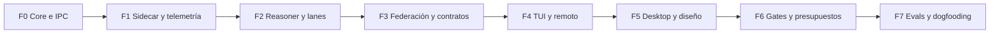

# 04 · Keel TUI y roadmap táctico

**Estado:** plan propuesto; ninguna fase se marca implementada por documentarla.
[PRD](01-prd-ui-spec.md) · [Arquitectura](02-systems-architecture.md) ·
[Modelo de datos](03-data-model-and-storage.md).

## 1. Cliente TUI de primera clase

Rust, Ratatui y Crossterm; consume el mismo protocolo y las mismas guardas que
la GUI. La TUI cubre el ciclo operativo completo: crear, planificar, ejecutar,
revisar, aprobar y cerrar. Diseño vectorial y preview visual pueden abrir
herramientas externas integradas; paridad operativa no significa renderizar un
canvas gráfico dentro de una terminal.

```text
┌ Keel · Project: storefront · Target: SSH · Daemon: connected ─────────────┐
│ [1] Board [2] Inspector [3] Run Tree [4] Workbench [5] Conns [6] Inbox (1) │
├───────────────────────────┬─────────────────────────────────────────────┤
│ RUNNING                   │ KEEL-104 · Define checkout contract         │
│ > KEEL-104 Contract       │ Repos: backend / frontend / docs            │
│   C3 · backend            │ Cost: $0.42 observed / $2.50 cap             │
│                           │ backend SHA: a12bc34 · branch: keel/104/...  │
│ BLOCKED                   ├─────────────────────────────────────────────┤
│   KEEL-105 Checkout UI    │ Root                                        │
│   checkout_api@1          │ ├─ Workflow: define contract                │
│   requires ready_for_mock│ │  └─ be-implement                          │
│                           │ │     └─ cargo test [done, wall 1.1s]        │
│ WAITING HUMAN             │ └─ Dependency: checkout_api@1 [draft]        │
│   KEEL-102 DB migration   │                                             │
├───────────────────────────┴─────────────────────────────────────────────┤
│ [a] Inspect approval [p] Pause [e] Neovim [g] Lazygit [t] PTY [q] Quit    │
└─────────────────────────────────────────────────────────────────────────┘
```

### Componentes

- `EventLoopTask`: teclado, resize y señales del terminal.
- `IpcWorkerTask`: snapshot inicial, cursor, solicitudes y reconexión con
  backoff.
- `StateStore`: proyecciones inmutables para render; mutaciones confirmadas por
  el daemon.
- `RenderTick`: dibujar al cambiar estado, limitando frecuencia bajo ráfagas de
  eventos.
- `ExternalToolHost`: salir de raw mode/alternate screen, ejecutar herramienta y
  restaurar terminal incluso ante error, cancelación o resize.

En terminal pequeña usar lista y panel único. Estados llevan texto además de
color; modo sin color, ayuda accesible, foco visible y bindings remapeables. El
indicador de desconexión deshabilita mutaciones que requieren una respuesta
actual del daemon.

### Controles

| Tecla              | Contexto                          | Acción                                                                 |
| ------------------ | --------------------------------- | ---------------------------------------------------------------------- |
| `1`–`6`            | Global, fuera de entrada de texto | Board, Inspector, Run Tree, Workbench, Connections, Inbox.             |
| `h/j/k/l`, flechas | Listas/árbol/tablero              | Navegar; expandir o colapsar según vista.                              |
| `Home` / `End`     | Listas                            | Primero/último; evita colisión con Lazygit.                            |
| `/`                | Vista                             | Buscar/filtrar.                                                        |
| `Enter`            | Selección                         | Abrir detalle.                                                         |
| `e`                | Referencia de código              | Neovim en archivo/línea del target seleccionado.                       |
| `g`                | Workbench                         | Lazygit en el worktree seleccionado.                                   |
| `t`                | Workbench                         | Adjuntar PTY o sesión TMUX de ese run/repo.                            |
| `p` / `r`          | Run                               | Solicitar pausa/reanudación; mostrar confirmación del supervisor.      |
| `a`                | Inbox                             | Inspeccionar operación y decidir; pulsar la tecla no aprueba a ciegas. |
| `d`                | Detalle de aprobación             | Denegar con razón opcional.                                            |
| `Esc`              | Modal/entrada                     | Volver o cancelar edición local.                                       |
| `?`                | Vista                             | Mostrar ayuda contextual.                                              |
| `q`                | Global, fuera de PTY/edición      | Desconectar TUI; los runs siguen en el daemon.                         |

Durante PTY/editor se entrega el teclado a la herramienta; un escape
configurable y visible recupera el foco de Keel. Salir de TMUX desconecta la
vista sin matar automáticamente el run. La integración remota abre herramientas
en el host correcto; un archivo remoto no se entrega a Neovim local como si
existiera en disco local.

## 2. Secuencia y criterios de salida

Las semanas 1–16 son una estimación inicial de planificación, no un compromiso
ni mediciones de trabajo realizado. La secuencia se organiza por dependencias;
cada fase termina con evidencia reproducible. Los controles básicos de
permisos/presupuesto preceden al primer agente; el inbox y watchdog completos
llegan en Fase 6.



### Fase 0 · Core daemon e IPC — semanas 1–2

- [x] Resolver mediante ADR la convivencia/transición Mirador–Keel antes de
      cambiar paquetes existentes. Resuelto por ADR-0001: Keel es un repo y un
      producto nuevos, Mirador queda como archivo y donante de fixtures, y se
      heredan reglas, no paquetes. Confirmado por el humano el 2026-10-23.
- [x] Daemon TypeScript sobre Bun (ADR-0003; Rust se reabre sólo con sus
      disparadores medidos), migraciones SQLite WAL, eventos, outbox y comandos
      idempotentes. Evidencia: `packages/daemon/test/commands.test.ts` y
      `outbox.test.ts`.
- [x] JSON-RPC por UDS/Named Pipes, permisos de endpoint, snapshot y cursor de
      reconexión. UDS en POSIX y AF_UNIX en Windows con la ACL del usuario
      (ADR-0005 §1, revisión 2026-10-23), probados con el daemon real en las dos
      plataformas.
- [x] Git engine con worktrees aislados, base SHA, cleanup recuperable y
      preservación de cambios. `@keel/git` más
      `packages/daemon/src/workspaces.ts`; evidencia en
      `packages/daemon/test/phase0.test.ts`, que cubre la tarea, el worktree
      real, el cambio, el reintento idempotente, la liberación,
      `foreign_key_check` y el crash.
- [x] Esquema preparado para múltiples repos aunque el primer recorrido use uno:
      `project_repos` y `run_worktrees` (SDD 03), con el repo primario
      registrado al primer run.

**DoD:** una integración crea workspace/proyecto/tarea, aprovisiona un worktree
real, registra un cambio Git y libera recursos. Reintentar el comando devuelve
el mismo resultado; reiniciar entre commit y entrega de outbox conserva el
evento. `foreign_key_check` y restore pasan. Registrar latencia y entorno de
Windows y POSIX sin presuponer resultados submilisegundo.

**Estado del DoD (2026-10-23).** Cumplido en POSIX y en Windows nativo.

- La integración completa está en `phase0.test.ts`, la caída entre commit y
  entrega del outbox en `outbox.test.ts`, el restore con `foreign_key_check` en
  `backup.test.ts` y la reconciliación de procesos por identidad en
  `processes.test.ts`.
- Los 162 tests pasan en Linux (WSL2) y en Windows 11.
- Las latencias de ambos están en [docs/benchmarks](../benchmarks/README.md).
- El shell de Tauri compila y su transporte pasa `cargo test` contra el daemon
  real en Windows. En Linux falta instalar GTK y WebKit en el entorno.

### Fase 1 · Sidecar, autenticación y telemetría — semanas 3–4

- [x] Supervisor de procesos de proveedor dentro del daemon (ADR-0003 §1: no hay
      sidecar separado), cancelación y backpressure. Keel lanza el proceso y
      registra su identidad (`processes.ts`), aplica un tiempo máximo por run
      (`max_wall_ms`) y clasifica cada final (`run-outcome.ts` de `@keel/core`).
      El backpressure del IPC viene de la Fase 0 (ADR-0005 §4).
- [ ] Adaptadores oficiales con matriz de capacidades y versiones; login
      delegado al proveedor. Claude hecho, con capacidades medidas
      (`ProviderCapabilities`). Codex espera a ADR-0008.
- [ ] Verificar qué modos de cuenta/suscripción admite cada integración; API
      facturada explícita. Claude según ADR-0002. Los términos de OpenAI para el
      login de ChatGPT los verifica el humano (ADR-0008 §2).
- [x] Ingesta saneada, eventos desconocidos, labels y métricas de duración con
      procedencia. Redacción best-effort con reglas versionadas en el borde
      (`redaction.ts`, `RunContext.ingest`). Los `kind` desconocidos se guardan
      íntegros. Labels de tool calls y duración del runtime (`duration_ms`)
      separada del reloj del daemon (`wall_ms`).
- [ ] Correlación con fixtures de Mirador: padres, workflows, utilitarios y
      orphans visibles. El oráculo de `@keel/core` pasa contra los fixtures de
      Mirador; falta que el daemon proyecte con él las fuentes sin identidad
      nativa (CLI y Codex).
- [x] Permisos mínimos, límites de tiempo/tokens/concurrencia y presupuesto
      antes de spawn. Herramientas de sólo lectura auto-aprobadas, el resto por
      el gate. `limits.ts`: 1 run a la vez, 2 USD por run y 10 USD por día
      estimados por defecto, que se suben con flags explícitos y se ven en
      `daemon.health`.
- [ ] Aislamiento desacoplado de git (deuda de la Fase 0, decidida el
      2026-10-22). Decidido en ADR-0010 (aceptado): `WorkspaceDriver` con
      `GitWorktreeDriver` y `DirectFsDriver`, y las tools de `@keel/git` para el
      agente por el puente MCP de ADR-0009.

**DoD:** un agente autorizado consulta archivos reales de un worktree y emite
eventos correlacionados. Fixtures redactados producen el oráculo esperado. Auth
expirada, proveedor sin capacidad, sidecar muerto y stream incompleto tienen
salidas explícitas; no hay fallback de facturación silencioso ni tokens de login
en los artefactos de prueba.

**Estado del DoD (2026-10-23).**

- Una corrida real de Claude leyó archivos de su worktree y emitió eventos
  correlacionados ([evidencia](../reviews/2026-10-23-fase1-corrida-real.md)).
- Auth expirada, proveedor sin capacidad, proceso muerto y stream incompleto
  tienen salidas explícitas (`outcomes.test.ts`).
- La redacción impide credenciales en los eventos (`redaction.test.ts` y el grep
  de CI).
- Falta el adaptador de Codex (ADR-0008) para la parte de «proveedor sin
  capacidad» en un segundo proveedor.

### Fase 2 · Reasoner, complexity gate y lanes — semanas 5–6

- [ ] DAG validado y versionado, estimaciones, C1–C5, roles y scopes por repo.
- [ ] C1–C2 con un worker; paralelismo superior justificado y acotado por
      presupuesto.
- [ ] Scheduler con adquisición atómica, leases, fencing y manejo conservador de
      globs.
- [ ] Checks deterministas, baseline delta-verde, evidencia ligada a SHA y flujo
      `needs_review`.
- [ ] Harness formal, brief/contrato congelado, `grilling` y roles de solo
      lectura.

**DoD:** dos workers intentan modificar el mismo scope; el segundo espera hasta
liberar e integrar el primero. Casos con `?`, clases, `**` y archivos nuevos no
se escapan del lock. Dos repos distintos con el mismo path relativo pueden
avanzar de forma independiente. Crash/reinicio no deja dos escritores
autorizados en una lane.

### Fase 3 · Multi-repo, Context Hub y Contract Gates — semanas 7–8

- [ ] `project_repos` y `run_worktrees`, incluyendo aislamiento de lanes dentro
      de un repo.
- [ ] Resolver `shared_dirs`/`always_read` por alias y snapshot, con manifest y
      read-only real.
- [ ] Shared Research con FTS5, `sqlite-vec`, embeddings locales versionados y
      reindexación.
- [ ] TTL de 48 horas, snapshot exacto y lease de investigación para evitar
      carreras.
- [ ] `KeelEmitCrossFinding`, dedupe por incidente y `auto_triage` bajo límites
      de ejecución.
- [ ] Versiones inmutables y eventos de contrato; dependencias fijadas y outbox
      recuperable.
- [ ] Generación tipada de SDK/MSW y reconciliación idempotente ante v2.

**DoD:** backend/frontend/docs independientes. Frontend espera `checkout_api@1`;
backend publica `ready_for_mock` validado; el scheduler inicia frontend una sola
vez y produce mocks contra el hash de v1. Publicar v2 conserva v1 y crea una
subtarea por consumidor con diff. Agregar una dependencia cuando el contrato ya
está listo también la satisface. Deprecar, otro bloqueo abierto o una pausa
humana impiden iniciar un worker indebidamente.

**Evidencia adicional:** dos consultas del mismo incidente comparten una
investigación; cambiar el SHA de cualquiera de sus fuentes invalida el reuso.
Repetir un hallazgo no crea otro bug. Con embeddings caídos funciona FTS y la UI
indica degradación. Reiniciar entre publicación y notificación no pierde ni
duplica el desbloqueo.

### Fase 4 · TUI, terminal y remoto — semanas 9–10

- [ ] Ratatui/Crossterm con seis vistas, búsqueda, navegación y estado
      desconectado.
- [ ] `portable-pty`, perfiles de shell, Starship/dotfiles, Neovim y Lazygit.
- [ ] Bridge Windows/WSL2 con ejecución cerca del filesystem Linux y traducción
      de paths.
- [ ] Daemon remoto, SSH, sesiones TMUX por run/repo y acceso interactivo
      opcional por Mosh.
- [ ] Reconexión por cursor sin depender de la vida del cliente.

**DoD:** resolver un ciclo de tarea y revisión exclusivamente desde la TUI en
SSH; desconectar el cliente y recuperar los mismos eventos/runs. Abrir Neovim en
la línea del diff, usar Lazygit y volver con el terminal restaurado. La matriz
incluye Windows nativo, WSL2, macOS y Linux, declarando diferencias o
capacidades no disponibles en cada uno.

### Fase 5 · Desktop y Design Studio — semanas 11–12

- [ ] Tauri v2, React y Tailwind; app shell y pantallas funcionales 00–11.
- [ ] Contrastar el canvas pen.dev original cuando esté disponible.
- [ ] Dual board, inspector, run tree y diff multi-repo sobre las mismas APIs de
      la TUI.
- [ ] Preview aislado con puertos registrados y túneles remotos controlados.
- [ ] Spike OpenPencil `.op`/`op-web-sdk`: licencia, API, formatos y
      compatibilidad verificadas.
- [ ] Importar artefactos, diff visual y flujo de traducción a componentes con
      revisión.

**DoD:** tarea creada desde TUI aparece en GUI, con árbol vivo, bloqueos y
costos honestos. Revisar un diff backend/frontend y evidencia visual. Si el SDK
de diseño no es compatible, el spike debe resolver una alternativa concreta
antes de dar la integración por terminada.

### Fase 6 · Inbox durable y presupuestos — semanas 13–14

- [ ] Reglas `auto`/`ask`/`dry_run_then_ask`/`deny`, grants acotados y TTL.
- [ ] Aprobación ligada a hash de operación, target, scope y revisión.
- [ ] Separar retención del daemon y timeout del proveedor; reintentos
      validados.
- [ ] Watchdog con reservas de costo por worker/descendientes y cancelación del
      grupo.
- [ ] Pausa, directriz nueva, checkpoint y reanudación explícita.

**DoD:** una mutación SQL permanece sin ejecutar hasta resolver su gate.
Enmendarla invalida el permiso anterior; el TTL expirado deniega ejecución.
Superar el presupuesto observado bloquea nuevo trabajo y termina el intento con
`budget_exceeded`. Medir tiempo local de reacción y costo pendiente remoto; no
afirmar gasto cero adicional sin evidencia del proveedor.

### Fase 7 · Evals y dogfooding — semanas 15–16

- [ ] Corpus de al menos 20 tareas históricas con entrada, repos/SHAs, contrato
      y criterio de éxito.
- [ ] Review cruzado entre familias cuando estén disponibles; fallback visible
      si falta proveedor.
- [ ] Carga de 50,000 eventos, lectores concurrentes y backpressure; medir
      latencia y tamaño WAL.
- [ ] Fault injection: sidecar/daemon caídos, red perdida, reloj de pared
      ajustado, disco lleno.
- [ ] Backup/restore, rebuild de FTS/vector y replay idempotente de
      outbox/reconciliaciones.
- [ ] Evaluación de calidad del embedding con código y consultas ES/EN antes de
      fijar modelo.

**Criterio final:** completar tres tareas reales del propio Keel de extremo a
extremo desde GUI/TUI, incluyendo una federada con v2 y una sesión remota
recuperada. Terminales, Neovim y Lazygit lanzados desde Keel cuentan como parte
del flujo. Cada tarea conserva revisión humana, SHAs, diff, evidencia
independiente, actividad y promoción a canon cuando corresponda.

## 3. Matriz de riesgos y decisiones pendientes

| Decisión                         | Validación requerida                                                         | Fase |
| -------------------------------- | ---------------------------------------------------------------------------- | ---- |
| Integración con Mirador          | ADR de transición, compatibilidad de fixtures y límites entre paquetes.      | 0–1  |
| CLI/SDK/app-server por proveedor | Auth admitida, scopes, cancelación, permisos y recuperación real.            | 1    |
| Costo por suscripción            | Qué cuota/costo expone el proveedor; representar desconocido cuando aplique. | 1/6  |
| Embedding local                  | Licencia, tamaño, distribución, calidad ES/EN y latencia en hosts objetivo.  | 3/7  |
| Contratos TS/Proto/OpenAPI       | Comparador y generador por formato, refs y criterios de breaking change.     | 3    |
| Bridge y PTY                     | Paths, ACL, señales y reconexión en matriz de plataformas.                   | 0/4  |
| Canvas externo                   | Archivo original y API OpenPencil verificada.                                | 5    |

## 4. Handoff y promoción a canon

Cada fase deja decisiones y fuentes en los documentos canónicos, evidencia de
checks, limitaciones reproducibles y enlaces a tareas abiertas. El handoff
contiene IDs de tareas, runs, manifest de SHAs, cursor de eventos y siguiente
acción; evita copiar secretos o duplicar specs. `Done` y `Archived` siguen
siendo resultados del flujo humano, no casillas que un agente marque para dar
por terminada una fase sin evidencia.
